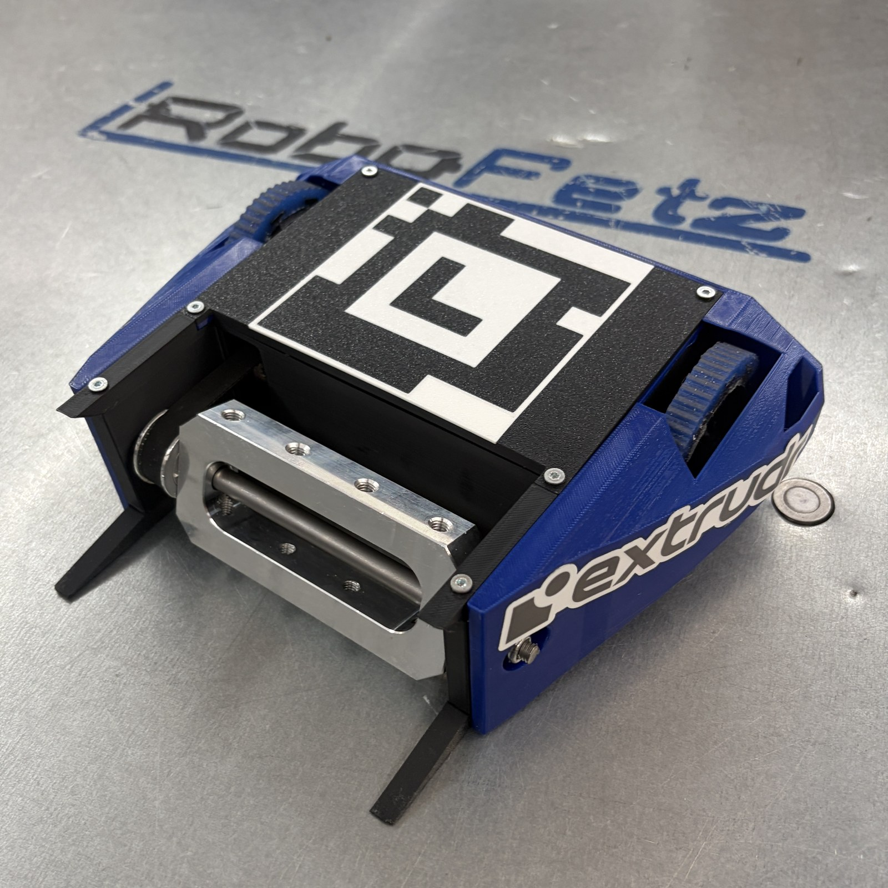
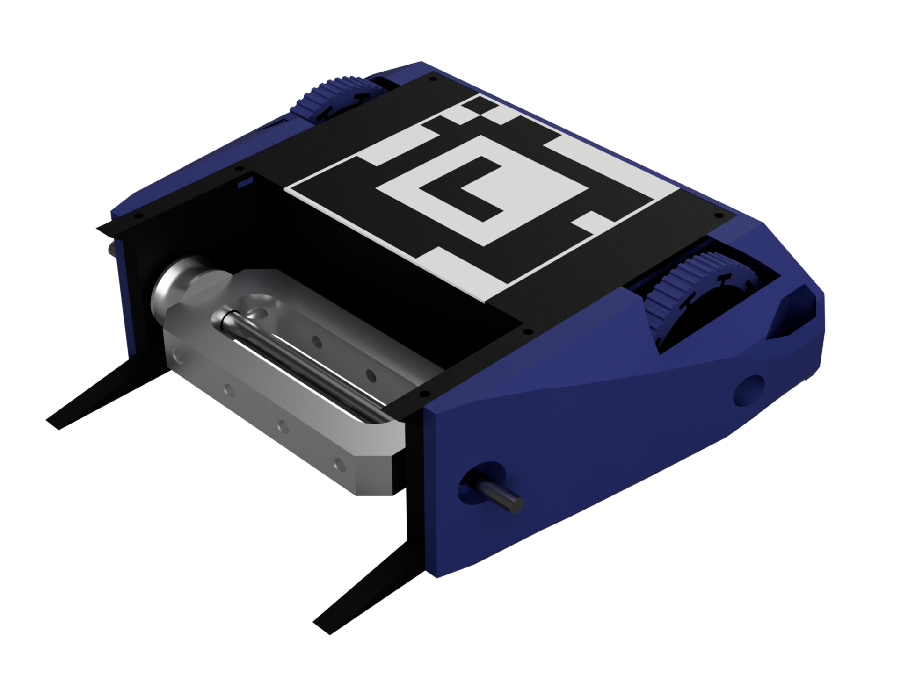

# ROBOFETZ_AS

ROBOFETZ_AS is a hands-on project for learning combat robot autonomy with ROS 2
Jazzy. It combines arena perception, localization, strategy, navigation, and
robot control. Elf is the default strategy in Gazebo and on the physical robot.

## Robot hardware

| Elfbar prototype | CAD model |
| --- | --- |
|  |  |

## Choose how to run it

| Approach | Choose it when | How it runs |
| --- | --- | --- |
| **VS Code Dev Container** | You want to edit, build, and test ROS packages. | VS Code opens your checkout inside a container. Gazebo and RViz appear in a browser desktop, with optional Xbox controller passthrough for the simulated opponent. |
| **Standalone Docker Compose** | You want to run the simulator from a terminal without an editor. | Compose builds an image from the current checkout and serves the simulation desktop in your browser. Rebuild the image after changing source. |
| **Native Ubuntu 24.04** | You want to connect the real robot or run ROS directly on your workstation. | ROS 2 Jazzy and Gazebo run on the host. Use Gazebo for simulation or connect the arena camera, radio bridge, and gamepad for hardware bringup. |

Both container workflows supply ROS and Gazebo and are configured for
simulation. On Windows, use either workflow from Ubuntu 24.04 under WSL 2.
The keyboard works in both workflows. The optional Xbox profile needs a
controller input device visible to the Linux Docker host.

[Installation and first run](docs/installation.md) ·
[Dev Container workflow](docker/DEVCONTAINER.md) ·
[Xbox controller passthrough](docker/DEVCONTAINER.md#xbox-controller-passthrough) ·
[Docker Compose workflow](docker/README.md)

## Project documentation

- [System architecture](docs/architecture.md) traces the data flow from the arena camera to the robot.
- [Autonomy guide](docs/autonomy.md) explains Elf and the available strategy variants.
- [Package guides](docs/packages/README.md) cover node interfaces and launch options.
- [Firmware guide](docs/firmware.md) covers the ESP32 and radio link.
- [Contributor guide](AGENTS.md) covers workspace conventions and validation.
