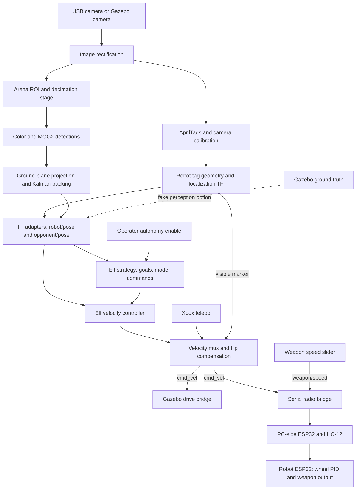
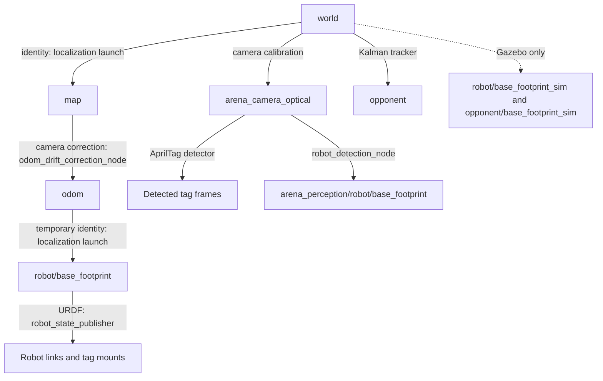
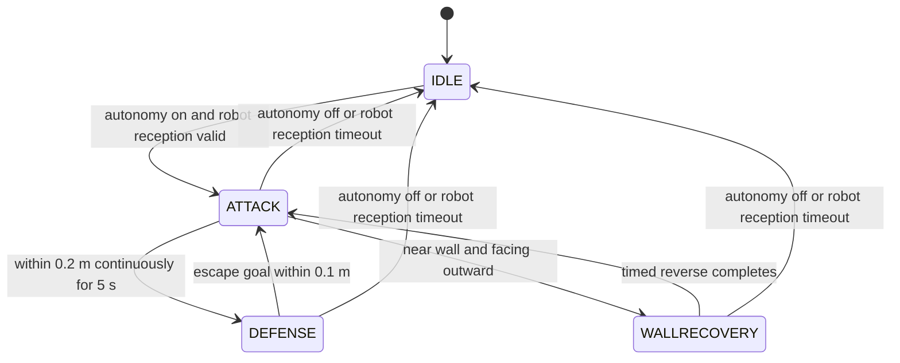
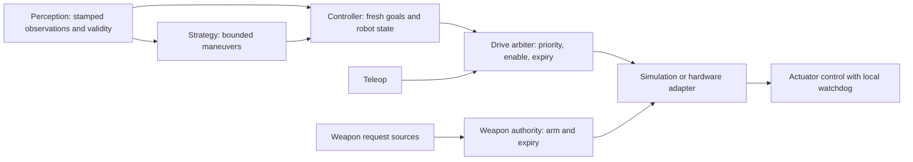

# ROBOFETZ_AS architecture and assessment

Source review: 2026-10-27. This describes the checked-in launch composition and
code, with isolated checks of selected failure paths. It is not a live robot
commissioning report or a performance benchmark.

## Assessment

The system has a sensible foundation for a small, camera-observed arena: separate
perception, strategy, control, robot geometry, simulation, and hardware adapters.
The default is a lightweight reactive **Elf** stack. Nav2 is an optional parallel
implementation, not a dependency of default autonomous motion.

The highest-value work is tightening the contracts between the existing parts:
image coordinates and calibration, observation freshness, command expiration,
clock domains, and ownership of actuator outputs. Those issues can invalidate
otherwise reasonable algorithms. A broad rewrite is not necessary to address
them.

## Runtime overview

Solid arrows describe the default camera/Elf composition. Fake perception replaces
camera processing in simulation. Weapon commands follow a separate route from drive commands.

The camera path above expresses responsibilities. The current image-size mismatch
within that path is detailed below. The fake branch actually relays ground-truth
frames into perception frames and uses the same localization chain for the robot.

### Launch ownership and variants

The root is [robot_bringup/launch/robofetz_as.launch.py](../src/robot_bringup/launch/robofetz_as.launch.py).

| Composition | Selected components | What remains separate |
| --- | --- | --- |
| Default simulation | Robot description; Gazebo; camera perception; localization; Elf; mux; opponent keyboard teleop; weapon slider; optional RViz | Nav2, defense map, automatic weapon controller |
| Fake-perception simulation | Ground-truth TF relays replace camera pipeline; localization, Elf, mux remain | Does not exercise camera calibration, detection, or marker-driven flip detection |
| Hardware (`use_sim:=false`) | USB camera; serial radio bridge; camera perception; localization; Elf; robot Xbox teleop; mux; slider | No micro-ROS agent launched; no ROS wheel/IMU fusion in default localization |
| Rhino alternative | Simple target forwarding, simple controller, weapon controller | Not selected by root bringup; needs surrounding perception/transport composition |
| Nav2 alternative | Navigation servers, map server, lifecycle manager, smoothed-velocity relay; separate `nav2_attack` process | Different pose topics and direct `/cmd_vel` publishers need integration |

Root defaults are simulation on, fake perception off, pinhole world, and RViz on.
The standalone Gazebo launch defaults to the wide-angle world instead; README
marks wide-angle usage unsupported. `use_fake_perception` is documented as
simulation-only but the root launch does not enforce that combination.

Root startup timers are 3 s for Gazebo, 8/3 s for perception in simulation/hardware,
20/15 s for localization, 25/20 s for RViz, and 30 s for Elf. Included launches add
their own delays. These delays sequence process starts; they do not prove camera,
TF, or localization readiness. `launch_rviz:=false` does not remove the slider,
interactive color selection, or all other GUI dependencies.

### Perception and localization

1. USB or Gazebo supplies image and camera calibration. `image_proc` rectifies;
   the custom AprilTag node detects robot top/bottom tags and the arena tag.
2. `find_camera_in_world_service` loads a stored camera transform or attempts
   calibration from the known arena tag. It also exposes the `find_camera_in_world`
   Trigger service. Tag dimensions/mounts and camera intrinsics are physical
   calibration inputs, not interchangeable tuning values.
3. `robot_detection_node` combines a detected tag transform with the corresponding
   URDF tag-to-footprint geometry. It selects a valid marker and publishes the
   detected footprint TF and visible-marker string. It includes transform-age
   checks and startup retries for mounting transforms.
4. `roi_mask_node` projects arena bounds into the image and masks outside them.
   A crop/decimate node defines an image and CameraInfo pair at half resolution
   in each dimension. Color and MOG2 detectors suppress the robot's image region.
5. Two converter nodes cast camera rays onto `z=0` in `world`. A constant-velocity
   Kalman tracker associates detections with a distance gate and uses per-source
   noise values. It publishes `world -> opponent` at 20 Hz and removes a track
   after the configured loss interval (currently `max_missed_detections * 0.1 s`).
   Heading comes from velocity with smoothing and low-speed retention.
6. TF adapters expose robot and opponent poses to the control stack. This is also
   where source timestamps are currently lost.

Primary sources: [perception launch](../src/arena_perception/launch/arena_perception.launch.py),
[fusion launch](../src/arena_perception/launch/opponent_Fusiondetection.launch.py),
[tracker](../src/arena_perception/arena_perception/detection_kalman_filter.py),
[localization launch](../src/arena_perception/launch/robot_localization.launch.py).

### TF ownership

In fake mode, relays instead publish perception footprint frames from ground
truth; its opponent adapter reads `arena_perception/opponent/base_footprint`
instead of `opponent`. The robot adapter reads `robot/base_footprint` in both modes.
The fake TF relays additionally publish the older underscore-separated pose topics
used by the optional Nav2 stack; the normal camera pipeline does not supply those
same topics by default.

The correction computes `map -> odom` from camera-derived world pose and the
inverse `odom -> base` transform. Because `odom -> base` is currently identity,
motion effectively lives in `map -> odom`. This is a workable camera-localization
scaffold, but is not continuous wheel odometry with global drift correction.
Gazebo wheel-odometry and slip-TF bridge entries are commented out. The radio
bridge logs inbound serial text rather than publishing measured odometry.

### Default strategy and controller

The checks run at 20 Hz. ATTACK follows the opponent; DEFENSE picks the farthest
of four points offset 0.2 m from the configured arena center and requests backward
tracking. WALLRECOVERY sends one reverse command, waits distance/speed (2 s with
defaults), then stops and returns to ATTACK. The state has unused turn-related
parameters but no implemented turn phase. Proximity takes priority over wall
recovery when both trigger. DEFENSE has no completion timeout.

`elf_navigator` uses proportional distance control and PI heading control, bounded
speeds, angle wrapping, reverse tracking, and an integral limit. It does not plan
collision-free paths. The strategy publishes goal, drive mode, and immediate
commands on separate topics; the controller has no atomic maneuver message or
completion feedback. Its integral resets on every goal callback, including the
strategy's repeated 20 Hz target updates.

Sources: [Elf strategy](../src/combat_strategizer/combat_strategizer/elf_combat_strategizer.py),
[Elf controller](../src/robot_navigation/robot_navigation/elf_navigator.py).

## What is working well architecturally

| Strength | Why it is valuable | Keep or extend |
| --- | --- | --- |
| Clear package responsibilities | Strategy can evolve independently of camera algorithms and transport | Preserve these boundaries while clarifying shared interfaces |
| Separate strategy and velocity control | Discrete decisions and continuous control are independently understandable | Extract transition logic into testable functions without replacing the ROS shell |
| Simulation and fake perception | The same downstream loop can use synthetic ground truth or images | Turn fake mode into a repeatable integration test fixture |
| Calibrated geometry and TF | Robot mounts, camera pose, and world coordinates have explicit representations | Document transform ownership and retain observation timestamps |
| Complementary opponent detectors | Color and motion information feed one tracker with configurable noise | Fix coordinate consistency, then measure each source and fusion against ground truth |
| Teleop precedence and flip handling | Drive authority and robot orientation are centralized in one node | Extend the existing mux with expiry and explicit health/enable semantics |
| Firmware wheel feedback | Encoder/PID loops run near the actuators rather than over the radio | Add independent receive timeouts and expose feedback/health |

These are structural strengths demonstrated by the implementation. Accuracy,
latency, recovery success, and match reliability still need measured evidence.

## Improvements, in priority order

### 1. Make freshness and command lifetime explicit

**Observed:** [cmd_vel_muxer.py](../src/combat_strategizer/combat_strategizer/cmd_vel_muxer.py)
expires teleop after 0.5 s but never timestamps or expires autonomy. A controller
failure can therefore leave the mux publishing its last nonzero command at 20 Hz.
The [radio firmware](../micro_ros_esp32/diff_drive_bot_esp32_funk/diff_drive_bot_esp32_funk.ino)
also retains setpoints without a command-reception watchdog.

**Observed:** [tf_to_pose.py](../src/combat_strategizer/combat_strategizer/tf_to_pose.py)
reads latest TF and replaces its timestamp with the current time, without checking
transform age. Elf validates robot callback arrival time and never checks opponent
age. A lost camera or removed opponent track can leave a cached TF looking fresh
to strategy. The freshness checks earlier in localization do not close this gap.

**Change:** preserve measurement provenance and age; reject stale robot/opponent
observations; expire drive commands at the mux; add independent radio receive
timeouts. Define measurement time separately from predicted-state publication
time. The controller should also stop when its own inputs expire.

**Coupling to handle:** a mux timeout alone would cut short current wall recovery,
which sends reverse once. Make timed maneuvers renew their command while valid,
or give them an explicit bounded duration. Distinguish ROS-time behavior timers
from a monotonic hardware watchdog that must still work when simulation time stops.

**Acceptance check:** stop camera updates, stop strategy/controller publishing,
and interrupt transport independently; each layer must reach zero within its
declared deadline. A republished stale TF must not reset perception validity.

### 2. Match image coordinates to their calibration

**Observed:** [opponent_detection_config.yaml](../src/arena_perception/config/opponent_detection_config.yaml)
sets both detector inputs to `/arena_camera/image_rect_masked`. The fusion launch
remaps `/arena_camera/image_rect` to the cropped image, which does not match the
configured subscription. Meanwhile `/arena_camera/camera_info` is remapped to
cropped CameraInfo, and the 2D-to-3D converters also consume cropped CameraInfo.

The effective default is therefore full-size detection pixels paired with 2x
decimated intrinsics. That affects both self-masking and world-position projection.

**Change:** select one image/CameraInfo pair through explicit launch parameters
and use it consistently in detectors and converters. Derive pixel thresholds from
the selected resolution or keep them in named camera profiles.

**Acceptance check:** use known image points and calibration at both resolutions;
world coordinates should agree within a declared tolerance. Validate CameraInfo
dimensions against the actual image dimensions at startup.

### 3. Make launch configuration effective and reproducible

**Observed:** `elf_autonomy.launch.py` receives `use_sim_time` from its parent but
does not apply it to either node. The fusion launch declares the argument but
does not pass it to detector, projection, filter, or opponent TF-adapter nodes.
Elf strategy additionally uses `time.time()`. Parent launch arguments alone do
not set a ROS node's clock parameter.

**Observed:** root bringup computes `run_rectification` but the perception launch
never reads it and always starts rectification. Fixed startup delays mask readiness
dependencies. Some hardware setup is tied to source defaults and the
machine-specific `/home/bjorn/robofetz_as` path in `fetz_launch.sh`.

**Change:** explicit simulation/hardware profiles, consistent node clock settings,
one validated arena geometry configuration, and readiness checks for camera/TF.
Expose strategy and detector choice as mutually exclusive launch options. Add a
headless profile with no slider or interactive image windows.

**Acceptance check:** inspect every participating node's clock parameter; pause
and resume simulation; start from a cold workspace with slow camera initialization;
verify unsupported argument combinations fail with an actionable explanation.

### 4. Give actuator outputs one owner and unify contracts

**Observed:** the default mux owns drive output, but the optional Nav2 wrapper and
velocity relay publish directly to `/cmd_vel`. The old Nav2 pose topics differ
from Elf's topics. The optional weapon controller listens to `camera/pose`, while
default localization publishes `/robot/pose`.

**Observed:** the weapon slider publishes `/weapon/speed` directly to the radio
bridge. `/weapon/armed` only gates the optional weapon controller; it does not
gate this default path. Starting Rhino alongside root bringup would add another
weapon-speed publisher. The serial bridge sends PID messages that the checked-in
HC-12 robot parser does not implement.

**Change:** all drive sources go through one arbiter, with one selected autonomy
stack; all weapon sources go through one explicit arming/expiry owner. Define
and validate a shared controller command contract, including mode, goal, validity,
and completion/failure reporting. Align host/firmware protocol support.

**Acceptance check:** verify publisher ownership per profile, reject malformed
commands, and confirm every output path obeys the same stop/disarm semantics.

### 5. Add behavioral evidence and retire misleading integration debris

**Observed:** first-party tests are only flake8/pep257/copyright scaffolding, with
copyright checks skipped. Five perception console entry points refer to missing
module paths. The source file `static_tf_test'.py` has an extra apostrophe, so it
does not satisfy the `static_tf_test` entry point. Runtime dependencies are
incompletely described: for example, bringup has no runtime dependencies in its
manifest despite launching/importing several packages and serial support.

**Observed:** `nav2_attack.py` imports reusable conditions but shadows
`ProximityCondition` locally, duplicates state concepts, and uses its own defense
points rather than `map_node`. Its defense hold is 10 s after navigation becomes
IDLE, not the old AGENTS.md's 3 s. Treat Nav2 as an alternative needing integration
work, not as the documented default.

**Change:** remove or repair broken entry points, complete dependency declarations,
and label/archive experimental alternatives deliberately. Add small behavior tests
before wider refactors: Elf transitions and priority, timeout chains, image/world
projection, command arbitration, and transport parsing. Follow with a headless
fake-perception launch test and recorded-camera replay.

**Acceptance check:** clean package discovery/build; all advertised entry-point
modules exist; tests cover loss of inputs and recovery as well as nominal pursuit.
Record observation age, control delay, tracking error, and state transitions so
future tuning can be compared against a baseline.

## Suggested target boundaries

This is a proposed refinement, not the current implementation. It preserves the
existing packages and algorithms while making authority and validity explicit.

Implement freshness and coordinate fixes first, then launch/ownership cleanup,
then broader testing and observability. Consider fuller odometry fusion or Nav2
adoption only against a concrete requirement such as camera occlusion tolerance
or obstacle-aware navigation.

## Validation performed for this review

- `colcon list`: six first-party ament Python packages plus `slider_publisher`.
- Python AST parsing: 90 first-party package, launch, setup, and test files parsed
  without syntax errors; auxiliary `scripts/` assets were excluded.
- First-party package manifests parsed as XML; this does not validate dependency
  names or whether all dependencies are declared.
- Static entry-point audit found five absent perception module paths:
  `camera_rectification_node`, `static_tf_test`, `opponent_det_MOG2multiple`,
  `detection_transformation_2D_3D`, and `detection_2d_to_3d_node`.
- Isolated method probes, without ROS node initialization or publishing to DDS:
  the mux republished a cached nonzero autonomous command; the TF adapter converted
  a transform stamped at 1 s into a pose stamped at 120 s. YAML/remapping inspection
  confirmed the full-size-image/cropped-CameraInfo mismatch for both detectors.
- `bash -n fetz_launch.sh` passed; its hard-coded paths and quoted enable command
  still need functional correction. Shell syntax success is not execution success.

No full build, linter suite, Gazebo run, serial access, firmware flash, or physical
actuation was performed. The review's code-level findings are distinguished above
from proposed acceptance tests. Only documentation was changed.
