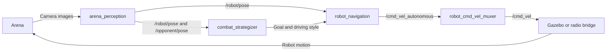
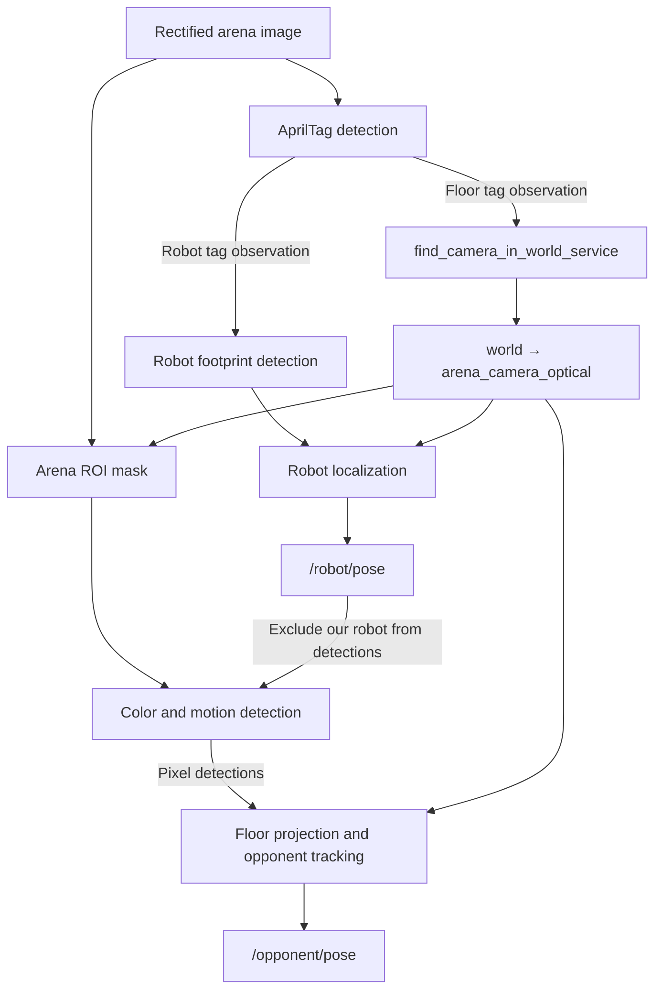
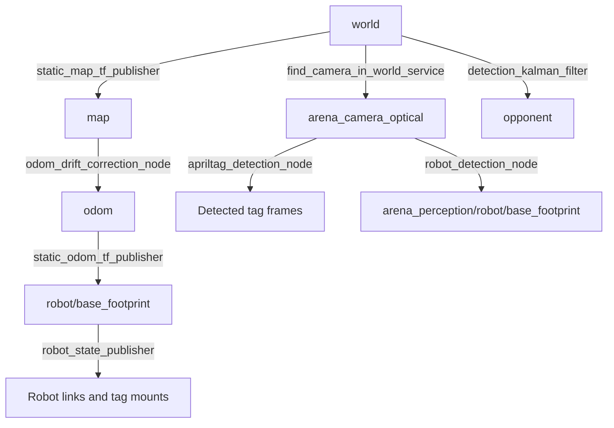

# System architecture

ROBOFETZ_AS uses an overhead camera to observe the arena and steer a combat
robot. Perception estimates where both robots are. The combat strategizer
chooses a maneuver, the navigator turns it into a velocity command, and
`robot_cmd_vel_muxer` selects the command that reaches the drive. The next
camera observations show how the robots moved.
[Root launch](../src/robot_bringup/launch/robofetz_as.launch.py) · [Package guides](packages/README.md)

## How the system runs

`robofetz_as.launch.py` selects the source of observations and the destination
of drive commands. The default strategy and navigator are Elf in all three
modes. Fake perception requires simulation because its pose relays read
Gazebo ground-truth TF.

| Mode | Where poses come from | Where drive commands go |
| --- | --- | --- |
| **Camera-based simulation** (default) | `gz_bridge` supplies the simulated pinhole camera's `/arena_camera/image` and `/arena_camera/camera_info` to the camera pipeline. | `gz_bridge` sends `/cmd_vel` to our simulated robot. Opponent teleop goes to Gazebo separately on `/opponent/cmd_vel`. |
| **Simulation with fake perception** (`use_fake_perception:=true`) | TF relays use Gazebo ground truth in place of camera observations. The pose adapters still supply `/robot/pose` and `/opponent/pose` in `world`. | The same Gazebo command paths apply. The fake perception launch supplies no visible-marker messages for flip detection. |
| **Hardware** (`use_sim:=false`) | The overhead USB camera supplies the image and camera information to the same camera pipeline. | The hardware gamepad feeds `/cmd_vel_teleop` to the mux. `radio_bridge_node` forwards the selected command over USB serial and the HC-12 radio link. |

[Bringup options](packages/robot_bringup.md#package-wiring) · [Gazebo bridge](packages/robofetz_gazebo.md#external-processes-and-bridge-interfaces) · [ESP32 firmware](firmware.md)

The root launch starts perception, localization, and Elf together. In
camera mode, localization publishes a pose once it can combine a detected
robot footprint with the calibrated camera transform. In fake perception,
the relays wait for Gazebo's ground-truth TF. Elf and opponent fusion use
Gazebo's `/clock` in simulation. Elf starts with autonomy disabled and
requires a recent robot pose before leaving idle.
[Startup sequence](../src/robot_bringup/launch/robofetz_as.launch.py)

## From camera observations to poses

The AprilTag detector starts with the rectified camera image and reports
tag poses in `arena_camera_optical`. `find_camera_in_world_service` uses the
known floor tag pose to establish the camera's pose in `world`. That TF
link is the prerequisite for arena masking and for turning camera
observations into robot and opponent positions in the arena.
[Camera-to-world calibration](packages/arena_perception.md#camera-to-world-calibration)

- **Our robot.** The detector combines the observed top or bottom tag with
  its fixed mount in the robot description to recover the base footprint.
  Localization expresses the footprint in `world`. The opponent detectors
  use that pose and camera TF to exclude our robot from their search.
  [Robot detection and localization](packages/arena_perception.md#robot-detection-and-localization)
- **The opponent.** Color and motion detectors report candidate pixels.
  Projection uses the camera TF to intersect their rays with the arena
  floor. A Kalman filter combines the measurements into one track whose
  heading follows the estimated motion.
  [Opponent detection and localization](packages/arena_perception.md#opponent-detection-and-localization)

### TF ownership

The robot's camera-frame detection and its localized footprint have
different frame names. The pose adapters read `robot/base_footprint` and
`opponent` relative to `world` and publish `geometry_msgs/msg/PoseStamped`
on `/robot/pose` and `/opponent/pose` in the default camera pipeline.
[Perception wiring](packages/arena_perception.md#package-wiring) · [Pose adapters](packages/combat_strategizer.md#pose-adapters-and-helpers)

The standard launch supplies identity transforms for `world → map` and
`odom → robot/base_footprint`. With no wheel odometry in that chain, the
camera-derived motion appears in `map → odom`. In fake perception, Gazebo
ground-truth relays supply the detected footprint frames. The robot still
goes through the localization chain, and the opponent pose adapter reads
the relayed `arena_perception/opponent/base_footprint` directly.
[Localization launch](../src/arena_perception/launch/robot_localization.launch.py) · [Fake perception launch](../src/arena_perception/launch/fake_arena_perception.launch.py)

## From a maneuver to motion

In a pursuit, `elf_combat_strategizer` uses `/opponent/pose` as the goal and
asks to drive forward. `elf_navigator` compares that goal to `/robot/pose`
and publishes linear and angular velocity. When Elf retreats, it sends a
defense goal in `map` and asks the navigator to drive backward. The navigator
compares coordinates directly, so this works with the identity
`world → map` transform in standard bringup.
[Elf strategy](packages/combat_strategizer.md#elf_combat_strategizer) · [Elf navigator](packages/robot_navigation.md#elf_navigator)

| Topic | What crosses the package boundary |
| --- | --- |
| `/autonomy` | The operator enables or disables Elf with a `std_msgs/msg/Bool`. |
| `/goal_pose` and `/drive_mode` | The strategizer gives the navigator a `PoseStamped` target and a `String` direction (`FORWARD` or `BACKWARD`). |
| `/elf_navigator_cmd` | The strategizer can interrupt goal tracking with a `String` command such as `STOP` or a straight reverse for wall recovery. |
| `/cmd_vel_autonomous` and `/cmd_vel_teleop` | The navigator and hardware teleop provide `geometry_msgs/msg/Twist` commands to the mux. |
| `/cmd_vel` | `robot_cmd_vel_muxer` publishes the selected `Twist` for the Gazebo bridge or radio bridge. |

The mux gives teleop priority for 0.5 s after the last teleop message.
Otherwise it republishes the latest autonomous command, or zero if none has
arrived. It uses the last top or bottom marker reported on
`/arena_perception/robot/visible_marker` and reverses linear x by default
when the bottom tag is visible. On hardware, `radio_bridge_node` also takes
an independent normalized weapon request on `/weapon/speed` as
`std_msgs/msg/Float32`.
[Velocity muxer](packages/robot_bringup.md#robot_cmd_vel_muxer) · [Radio bridge and firmware](firmware.md)

### Autonomy variants

| Variant | What it changes | Drive command path |
| --- | --- | --- |
| [Simple (historical Rhino example)](autonomy.md#simple-autonomy-stack) | The original direct-pursuit strategy forwards each opponent pose as a goal. `simple_navigator` steers forward toward it. | `simple_navigator` publishes `/cmd_vel_autonomous` for the mux. |
| [Elf (default)](autonomy.md#elf-autonomy-stack) | Adds pursuit, retreat, and wall recovery. `elf_navigator` tracks goals in either direction and accepts immediate commands. | `elf_navigator` publishes `/cmd_vel_autonomous` for the mux. |
| [Nav2 (optional example)](packages/robot_navigation.md#nav2_navigator) | `nav2_attack` uses the legacy pose topics and aligns before sending a `/navigate_to_pose` goal. It illustrates local alignment followed by path planning and tracking. | The wrapper and the Nav2 velocity relay publish directly to `/cmd_vel`. Combining them with the default mux creates competing publishers on the drive topic. |

## System improvements

| Boundary | Proposed change | How to check it |
| --- | --- | --- |
| Image processing → opponent projection | Deferred. Pair the full-size masked image with its camera info and project rectified pixels using `P`. [Perception improvement](packages/arena_perception.md#proposed-improvements) | Project a known arena-floor point and compare its estimated and measured positions. |
| Perception → strategy | Preserve observation timestamps and expire stale poses. The adapters restamp cached TF, and Elf retains the last opponent pose. | Interrupt camera updates and measure when the robot and opponent poses become stale to the strategy. |
| Controller → drive | Keep one publisher on `/cmd_vel` across controller variants. Renew timed maneuvers while active and give autonomous commands an expiry. | Check drive publisher ownership and verify that losing the controller leads to zero velocity in simulation. |
| Radio → actuators | Give drive and weapon requests independent deadlines in firmware. The radio firmware currently retains both setpoints. | In an explicit hardware test, interrupt the radio and measure when each actuator stops. |
