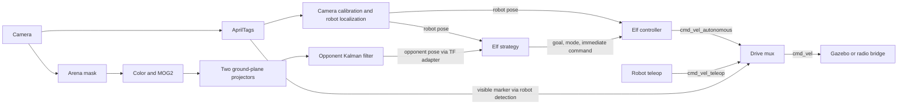
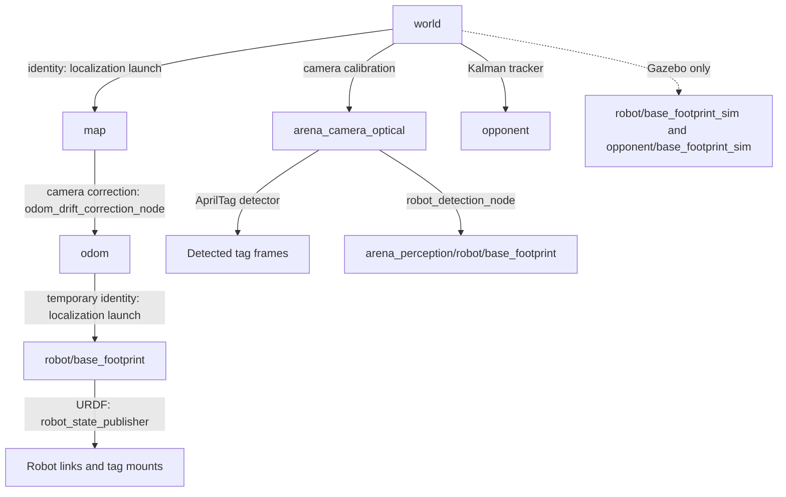

# System architecture

A fixed arena camera estimates the robot and opponent poses. Elf uses those poses to choose a maneuver. Its controller sends wheel-motion requests through the velocity mux to Gazebo or the radio bridge. [Root launch](../src/robot_bringup/launch/robofetz_as.launch.py) · [Package guides](packages/README.md)

## How the system runs

| Mode | Perception | Drive |
| --- | --- | --- |
| Default simulation | Gazebo pinhole camera → AprilTags for robot pose, color and motion for opponent pose. | Elf drives the robot via `/cmd_vel`. The operator drives the simulated opponent with Xbox teleop via `/opponent/cmd_vel` to test the robot’s response. |
| Fake perception (`use_fake_perception:=true` in simulation) | Ground-truth TF replaces the camera pipeline. Robot localization and both pose adapters remain active. | Same Elf controller and mux. Fake perception supplies no top/bottom marker for flip detection. |
| Hardware (`use_sim:=false`) | USB camera → same camera pipeline as simulation. | Robot Xbox teleop or Elf → mux → USB serial → HC-12 → ESP32 wheel controllers. Weapon slider → radio → weapon PWM. [Firmware](firmware.md) |

Root bringup starts perception after 8 s in simulation or 3 s on hardware, localization after 20/15 s and Elf after 30 s. These delays do not check readiness. Autonomy starts disabled.

## Observation and command paths

| Interface | Producer → consumer | Meaning |
| --- | --- | --- |
| `/robot/pose`, `/opponent/pose` (PoseStamped) | TF adapters → strategy. Robot pose also feeds controller and detector self-masking. | World coordinates. Opponent heading follows motion direction. |
| `/autonomy` (Bool) | Operator → Elf | Enables strategy. |
| `/goal_pose` (PoseStamped), `/drive_mode`, `/elf_navigator_cmd` (String) | Strategy → controller | Attack copies the opponent goal in `world`. Defense sets a `map` goal. The controller assumes these frames coincide. |
| `/cmd_vel_autonomous`, `/cmd_vel_teleop` → `/cmd_vel` (Twist) | Controller or robot teleop → mux → drive | Teleop takes priority for 0.5 s. Otherwise the mux repeats the last autonomous command. A bottom tag reverses linear x. |
| `/weapon/speed` (Float32) | Default slider → radio | Normalized request [0,1]. The optional `weapon_control` node has its own `/weapon/armed` gate. The slider publishes directly. |

## TF ownership

The camera-based correction carries the robot’s motion in `map → odom` because `odom → robot/base_footprint` is identity. The default radio and Gazebo paths supply no ROS wheel odometry. In fake mode the opponent adapter reads `arena_perception/opponent/base_footprint`. The robot adapter reads `robot/base_footprint` in both modes. [Perception wiring](packages/arena_perception.md)

## Autonomy approaches

| Approach | Strategy | Motion |
| --- | --- | --- |
| [Original direct pursuit (Rhino)](../src/combat_strategizer/launch/rhino_autonomy.launch.py) | Obsolete first iteration retained as a learning example. `simple_attack` forwards opponent poses directly to `/goal_pose`. | `simple_navigator` drives toward the goal. The launch also starts `weapon_control`. |
| [Elf (default)](../src/combat_strategizer/launch/elf_autonomy.launch.py) | Pursues the opponent. Within 0.2 m for 5 s, selects a defense point and drives backward. Near a wall and facing outward, commands a timed reverse. | `elf_navigator` tracks the goal or executes immediate commands. The mux selects the drive source. |
| [Optional Nav2](packages/robot_navigation.md) | `nav2_attack` selects targets and defense points from legacy pose topics. | Aligns locally, then sends `NavigateToPose` to external Nav2 servers. Alignment and the smoothed-velocity relay publish directly to `/cmd_vel`. |

## System improvements

| Current behavior | Proposed change | Check |
| --- | --- | --- |
| Detectors use full-size masked pixels with half-resolution CameraInfo. | Use one matching image/calibration pair for self-masking and projection. | Project a known arena point at both resolutions. |
| TF adapters restamp cached poses. Elf checks robot reception time and retains the opponent indefinitely. | Carry measurement time and validity through perception and control. | Stop camera updates and verify that both poses expire. |
| The mux and radio firmware retain commands. Elf wall recovery relies on a one-shot reverse. | Renew reverse commands for the maneuver duration. Expire drive and weapon requests independently at the actuator. | Interrupt the controller and the radio separately and measure time to zero. |
| The optional Nav2 path bypasses the mux. The slider and optional weapon policy can both publish weapon speed. | Route each drive source through the mux and each weapon request through one arming gate. | Check publisher ownership and stop/disarm behavior in each profile. |
| Elf and fusion use mixed clocks. Fixed launch delays can elapse before camera or TF is ready. | Propagate simulation time and gate startup on camera, calibration and TF availability. | Pause Gazebo and repeat startup with a delayed camera. |
