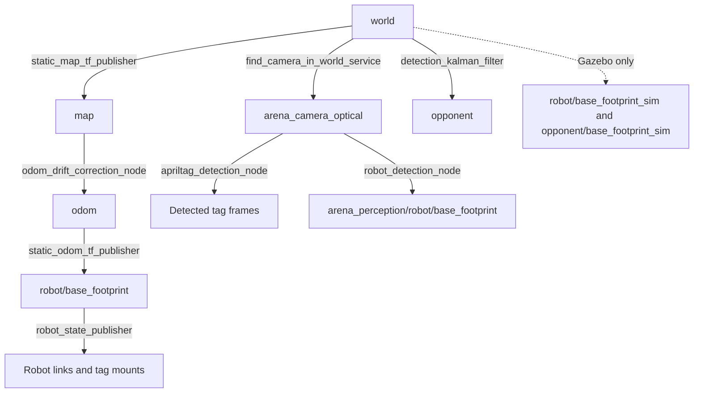

# System architecture

A fixed arena camera supplies images for estimating the robot and opponent
poses. `elf_combat_strategizer` uses `/robot/pose` and `/opponent/pose` to
choose a maneuver. `elf_navigator` sends velocity commands on
`/cmd_vel_autonomous`, and `robot_cmd_vel_muxer` publishes the selected
command on `/cmd_vel` for `gz_bridge` or `radio_bridge_node`.
[Root launch](../src/robot_bringup/launch/robofetz_as.launch.py) · [Package guides](packages/README.md)

## How the system runs

| Mode | Perception | Drive |
| --- | --- | --- |
| Default simulation | `gz_bridge` publishes the pinhole camera image on `/arena_camera/image` and calibration on `/arena_camera/camera_info`. | `gz_bridge` receives `/cmd_vel` for the robot and `/opponent/cmd_vel` from `teleop_twist_joy_node` for the opponent. |
| Fake perception (`use_fake_perception:=true` in simulation) | `robot_tf_relay` and `opponent_tf_relay` use Gazebo ground-truth TF. `robot_tf_to_pose` and `opponent_tf_to_pose` still publish the pose topics. | `elf_navigator` and `robot_cmd_vel_muxer` use the same command path. Fake perception supplies no `/arena_perception/robot/visible_marker` for flip detection. |
| Hardware (`use_sim:=false`) | `/arena_camera/usb_cam` supplies `/arena_camera/image` and `/arena_camera/camera_info` to the same perception pipeline. | `radio_bridge_node` forwards `/cmd_vel` and `/weapon/speed` over USB serial to the HC-12 radio path. [Firmware](firmware.md) |

Root bringup starts perception after 8 s in simulation or 3 s on hardware, localization after 20/15 s and Elf after 30 s. These delays do not check readiness. Autonomy starts disabled.

## Observation and command paths

```mermaid
flowchart LR
  Image["/arena_camera/image"] --> Rectify["/arena_camera/rectify_node"]
  Rectify -->|"/arena_camera/image_rect"| Tags["apriltag_detection_node"]
  Rectify -->|"/arena_camera/image_rect"| ROI["roi_mask_node"]
  Tags -->|"/tf"| Calibration["find_camera_in_world_service"]
  Tags -->|"/tf"| Detect["robot_detection_node"]
  Calibration -->|"/tf"| Odom["odom_drift_correction_node"]
  Detect -->|"/tf"| Odom
  Odom -->|"/tf"| RobotPose["robot_tf_to_pose"]
  ROI -->|"/arena_camera/image_rect_masked"| Color["opponent_det_ColorSingle"]
  ROI -->|"/arena_camera/image_rect_masked"| Motion["opponent_det_MOG2single"]
  Color -->|"/detections_2d/color"| Color3D["detection_2d_to_3d_color"]
  Motion -->|"/detections_2d/mog2"| Motion3D["detection_2d_to_3d_mog2"]
  Color3D -->|"/detections_3d/color_array"| Track["detection_kalman_filter"]
  Motion3D -->|"/detections_3d/mog2_array"| Track
  Track -->|"/tf"| OpponentPose["opponent_tf_to_pose"]
  RobotPose -->|"/robot/pose"| Strategy["elf_combat_strategizer"]
  RobotPose -->|"/robot/pose"| Navigator["elf_navigator"]
  OpponentPose -->|"/opponent/pose"| Strategy
  Enable["/autonomy"] --> Strategy
  Strategy -->|"/goal_pose, /drive_mode, /elf_navigator_cmd"| Navigator
  Navigator -->|"/cmd_vel_autonomous"| Mux["robot_cmd_vel_muxer"]
  Teleop["teleop_twist_joy_node (hardware)"] -->|"/cmd_vel_teleop"| Mux
  Detect -->|"/arena_perception/robot/visible_marker"| Mux
  Mux -->|"/cmd_vel"| Gazebo["gz_bridge (simulation)"]
  Mux -->|"/cmd_vel"| Radio["radio_bridge_node (hardware)"]
```

| Interface | Producer → consumer | Meaning |
| --- | --- | --- |
| `/robot/pose` (PoseStamped) | `robot_tf_to_pose` → `elf_combat_strategizer`, `elf_navigator`, and the opponent detectors | Robot pose in `world`. The detectors use it for self-masking. |
| `/opponent/pose` (PoseStamped) | `opponent_tf_to_pose` → `elf_combat_strategizer` | Opponent pose in `world`. Heading follows motion direction. |
| `/autonomy` (Bool) | Operator → `elf_combat_strategizer` | Enables strategy. |
| `/goal_pose` (PoseStamped), `/drive_mode` and `/elf_navigator_cmd` (String) | `elf_combat_strategizer` → `elf_navigator` | Attack copies the opponent goal in `world`. Defense sets a `map` goal. `elf_navigator` assumes these frames coincide. |
| `/cmd_vel_autonomous`, `/cmd_vel_teleop` → `/cmd_vel` (Twist) | `elf_navigator` or `teleop_twist_joy_node` → [robot_cmd_vel_muxer](packages/robot_bringup.md#robot_cmd_vel_muxer) → `gz_bridge` or `radio_bridge_node` | Teleop takes priority for 0.5 s. Otherwise the node repeats the last autonomous command. A bottom tag reverses linear x. |
| `/weapon/speed` (Float32) | Optional external publisher → `radio_bridge_node` | Normalized speed request [0,1]. |

## TF ownership

`odom_drift_correction_node` carries the robot’s motion in `map → odom`
because `odom → robot/base_footprint` is identity. The default radio and
Gazebo paths supply no ROS wheel odometry. In fake perception,
`opponent_tf_to_pose` reads `arena_perception/opponent/base_footprint`.
`robot_tf_to_pose` reads `robot/base_footprint` in both modes.
[Perception wiring](packages/arena_perception.md#package-wiring)

## Autonomy approaches

| Approach | Strategy | Motion |
| --- | --- | --- |
| [Original direct pursuit (Rhino)](../src/combat_strategizer/launch/simple_autonomy.launch.py) | Obsolete first iteration retained as a learning example. `simple_combat_strategizer` forwards opponent poses directly to `/goal_pose`. | `simple_navigator` drives toward the goal. |
| [Elf (default)](../src/combat_strategizer/launch/elf_autonomy.launch.py) | Pursues the opponent. Within 0.2 m for 5 s, selects a defense point and drives backward. Near a wall and facing outward, commands a timed reverse. | `elf_navigator` tracks the goal or executes immediate commands. `robot_cmd_vel_muxer` selects the drive source. |
| [Optional Nav2](packages/robot_navigation.md#nav2_navigator) | The `nav2_attack` executable selects targets and defense points from `/arena_perception_robot_base_footprint_pose` and `/arena_perception_opponent_base_footprint_pose`. | `nav2_navigator` aligns locally, then sends a goal on the `/navigate_to_pose` action. `nav2_navigator` and `relay_vel_republisher_cmd` publish directly to `/cmd_vel`. |

## System improvements

| Current behavior | Proposed change | Check |
| --- | --- | --- |
| `opponent_det_ColorSingle` and `opponent_det_MOG2single` read full-size `/arena_camera/image_rect_masked` with half-resolution `/arena_camera/cropped/camera_info`. | Use one matching image/calibration pair for self-masking and projection. | Project a known arena point at both resolutions. |
| `robot_tf_to_pose` and `opponent_tf_to_pose` restamp cached poses. `elf_combat_strategizer` checks robot pose reception time and retains the last opponent pose indefinitely. | Carry measurement time and validity through perception and control. | Stop camera updates and verify that both poses expire. |
| `robot_cmd_vel_muxer` and the radio firmware retain commands. Elf wall recovery relies on a one-shot reverse. | Renew reverse commands for the maneuver duration. Expire drive and weapon requests independently at the actuator. | Interrupt the controller and the radio separately and measure time to zero. |
| The optional Nav2 path bypasses `robot_cmd_vel_muxer`. | Route each drive source through `robot_cmd_vel_muxer`. | Check drive publisher ownership and stop behavior in each profile. |
| Elf and fusion use mixed clocks. Fixed launch delays can elapse before camera or TF is ready. | Propagate simulation time and gate startup on camera, calibration and TF availability. | Pause Gazebo and repeat startup with a delayed camera. |
