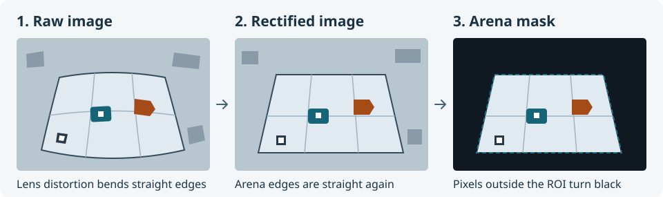
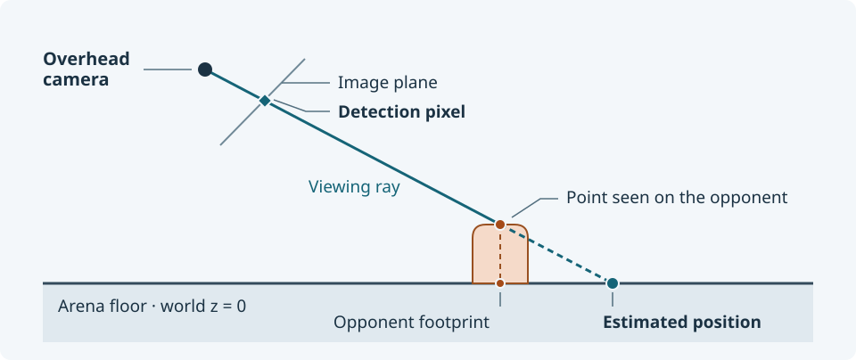
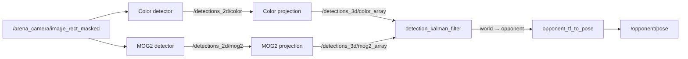
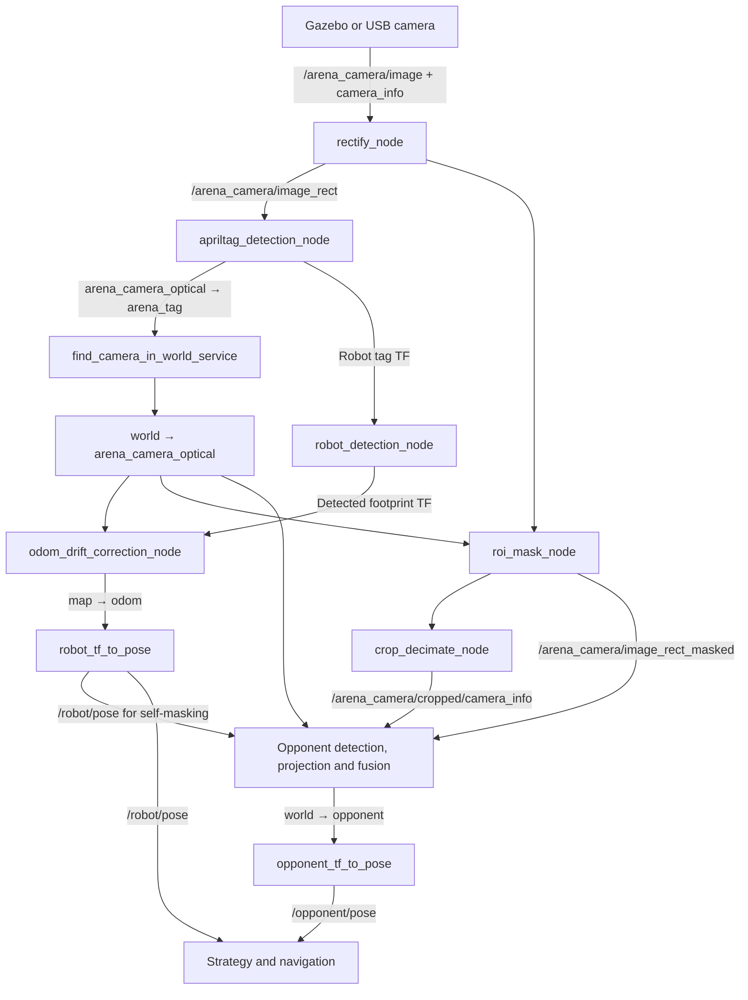

# arena_perception

`arena_perception` uses the fixed overhead camera to locate both robots in the
arena. Our robot carries AprilTags, so the camera can estimate its position and
orientation. The opponent needs no tag. The default detector tracks it using
color and motion and estimates its heading from the direction of travel.

The camera pipeline first needs to know where the camera is in the arena.
`find_camera_in_world_service` uses the fixed floor tag to establish the
transform between `arena_camera_optical` and `world`. That transform lets
the pipeline mask the arena boundary and localize both robots in `world`.

The perception launch uses pose adapters from `combat_strategizer` to publish
`/robot/pose` and `/opponent/pose` as `geometry_msgs/msg/PoseStamped` in
`world`. The strategizer uses both poses to choose a maneuver. The navigator
uses `/robot/pose` to steer.
[Combat strategizer guide](combat_strategizer.md) · [Navigator guide](robot_navigation.md)

## From camera image to arena coordinates

### Camera input and rectification

The camera supplies an image on `/arena_camera/image` and its calibration on
`/arena_camera/camera_info`. In default simulation these come from the Gazebo
pinhole camera through `gz_bridge`. On hardware, `usb_cam` is the default
(1920 × 1200 at 15 Hz). The standalone `camera_ros` launch is an alternative
driver configured for 800 × 600 MJPEG.
[Gazebo bridge configuration](../../src/robofetz_gazebo/parameters/bridge_parameters.yaml) · [USB camera settings](../../src/arena_perception/config/arena_camera_usb_config.yaml) · [Alternative camera launch](../../src/arena_perception/launch/arena_camera_ros.launch.py)

`/arena_camera/rectify_node` uses the lens calibration in `CameraInfo` to
correct distortion and publish the full-size image on
`/arena_camera/image_rect`. The camera intrinsics describe how points in
camera coordinates map to pixels. Matrix `K` describes the raw image and the
left 3 × 3 block of `P` describes the rectified image. They can differ, as
they do in the default USB camera calibration. For a physical camera, use a
lens calibration that matches the camera and capture resolution. The setup
manual shows how to collect one with a checkerboard.
[Preprocessing launch](../../src/arena_perception/launch/arena_perception.launch.py) · [ROS 2 CameraInfo definition](https://github.com/ros2/common_interfaces/blob/jazzy/sensor_msgs/msg/CameraInfo.msg) · [Default USB calibration](../../src/arena_perception/config/arena_camera_info_fs_arducam_1200p.yaml) · [Arena camera setup](../../src/arena_perception/Arena_Camera_Setup.md)

The optional `image_format_converter` converts YUYV input on `/image` to
RGB on `/image_rgb` by default. The camera launch files supply images directly
to the preprocessing pipeline.
[Converter source](../../src/arena_perception/arena_perception/image_format_converter.py)

### AprilTag detection

An AprilTag is a square marker with an encoded ID. Its corners, known edge
length and the camera intrinsics let the detector estimate its position and
orientation relative to the camera. `apriltag_detection_node` runs
`pyapriltags` on `/arena_camera/image_rect` and uses the projection matrix
`P` from the first `CameraInfo`. It broadcasts the visible tags as TF children
of `arena_camera_optical`. The debug image at
`/arena_perception/apriltag_detection/debug` shows the detected outlines.
[Detector source](../../src/arena_perception/arena_perception/apriltag_detection_node.py)

| ID in `tagStandard41h12` | Marker | TF child frame | Edge used for pose estimation |
| ---: | --- | --- | ---: |
| 11 | Robot top | `arena_perception/robot_top_tag` | 0.0522 m |
| 13 | Robot bottom | `arena_perception/robot_bottom_tag` | 0.0522 m |
| 2 | Arena floor | `arena_tag` | 0.0833 m |

The two robot tags let the same camera locate the robot upright or flipped.
The floor tag gives the camera a fixed reference in the arena.
[Tag IDs, sizes and frame names](../../src/arena_perception/config/arena_perception_config.yaml) · [Robot tag mounts](../../src/robot_description/urdf/robot.urdf.xacro)

### Camera-to-world calibration

At startup, `find_camera_in_world_service` takes the floor tag detection from
`apriltag_detection_node` and combines it with the tag's known pose in
`world`. It inverts the observed camera-to-tag transform to get the camera
pose relative to the tag, then composes it with the known tag pose. The node
broadcasts the result in TF with `world` as the parent and
`arena_camera_optical` as the child. TF can use that link in both directions.

- `roi_mask_node` maps the arena boundary from `world` into the camera image.
- `odom_drift_correction_node` uses it to express our robot's detected
  footprint in `world`.
- The opponent detectors use it to project our robot's pose into the image
  for self-masking. The opponent projectors use it to turn a detection
  pixel into a position on the arena floor.

AprilTags and opponent contours can be detected in the image before
calibration. The camera-based pipeline needs the transform to publish
`/robot/pose` and `/opponent/pose` in `world`.

The default floor tag position is (0.15, 0.15, 0) m with roll, pitch and yaw
of approximately (0, π, π/2). The node publishes that reference as
`world → arena_tag_calibrated`. It attempts calibration at 2 Hz until it
collects ten samples. It takes the median translation and averages the
orientation quaternions, then republishes the camera transform at 15 Hz.
Each call to `/find_camera_in_world`
(`std_srvs/srv/Trigger`) attempts one sample. The node can load a pose from
`calibration_file`. The default configuration relies on the tag because the
referenced file is absent from the repository.
[Calibration source](../../src/arena_perception/arena_perception/find_camera_in_world_service.py) · [Floor tag and calibration settings](../../src/arena_perception/config/arena_perception_config.yaml)

#### Proposed improvement

- Preserve the image timestamp on tag transforms and collect distinct,
  recent observations for calibration. The current lookup can reuse a cached
  transform across attempts.

### Arena masking and downsampling

Once the camera transform is available, `roi_mask_node` can project the
arena floor rectangle into the image. The region of interest (ROI) spans
−0.1 to 1.6 m on both axes at `world` z = 0. The node blacks out pixels
outside the projected rectangle and publishes
`/arena_camera/image_rect_masked`. Until it can project the boundary, it
passes the rectified image through unchanged.
[ROI mask source](../../src/arena_perception/arena_perception/roi_mask_node.py) · [Arena settings](../../src/arena_perception/config/arena_perception_config.yaml)

`/arena_camera/crop_decimate_node` halves the width and height of the masked
image. The launch uses zero offsets and keeps the full field of view. The
node exposes `/arena_camera/cropped/image_rect_masked` and
`/arena_camera/cropped/camera_info`. The opponent section describes which
of these topics the detectors use.
[Preprocessing launch](../../src/arena_perception/launch/arena_perception.launch.py)

## Robot detection and localization

`robot_detection_node` selects the newest robot tag transform up to 0.2 s
old. It combines that measurement with the corresponding fixed tag-to-base
transform from the robot description and publishes
`arena_camera_optical → arena_perception/robot/base_footprint` at 15 Hz.
It publishes `top`, `bottom` or `none` on
`/arena_perception/robot/visible_marker` when the selection changes.
`robot_cmd_vel_muxer` uses `bottom` to reverse the sign of the forward drive
command. If both tags age out, new detected footprint transforms stop.
[Robot detection source](../../src/arena_perception/arena_perception/robot_detection_node.py) · [Velocity muxer](robot_bringup.md#robot_cmd_vel_muxer)

`odom_drift_correction_node` uses the calibrated camera transform to locate
the detected footprint in `world`. It updates `map → odom` at 15 Hz while
the detected footprint transform in `world` is at most 0.1 s old. This makes
the standard `world → map → odom → robot/base_footprint` chain agree with
the detection. The default localization launch supplies identity transforms for
`world → map` and `odom → robot/base_footprint`, so the camera-derived motion
appears in `map → odom`. `robot_tf_to_pose` reads the standard footprint
frame in `world` and publishes `/robot/pose`.
[Localization launch](../../src/arena_perception/launch/robot_localization.launch.py) · [Correction source](../../src/arena_perception/arena_perception/odom_drift_correction_node.py) · [Pose adapter](combat_strategizer.md#pose-adapters-and-helpers)

## Opponent detection and localization

### Detection variants

Both detectors in the default pipeline look for contours in the masked image.
They project `/robot/pose` into camera pixels to exclude a circle around our
robot. Each reports the largest acceptable contour as a
`vision_msgs/msg/Detection2DArray` with zero or one detection. The reported
box center is the contour centroid.
[Detector settings](../../src/arena_perception/config/opponent_detection_config.yaml)

| Variant | How it finds the opponent | Where it struggles |
| --- | --- | --- |
| [Color only](../../src/arena_perception/launch/opponent_detection_color.launch.py) | `opponent_det_ColorSingle` thresholds hue, saturation and value (HSV). Click the opponent in the selection window, or disable interactive selection in YAML to use configured HSV bounds. It can detect a stationary opponent. | Similar colors and lighting changes can produce false or missed detections. |
| [Motion only](../../src/arena_perception/launch/opponent_detection_mog.launch.py) | `opponent_det_MOG2single` learns the background with OpenCV MOG2 and searches the foreground after rejecting shadows. It needs no color selection. | A stationary opponent can blend into the background. Other movement can produce false detections. |
| [Fusion (default)](../../src/arena_perception/launch/opponent_Fusiondetection.launch.py) | Runs both detectors, projects their observations separately and feeds one Kalman track. Either detector can update the track when the other has no usable detection. | Both cues depend on the same camera geometry. Incorrect projection can shift both measurements. |

[Color detector source](../../src/arena_perception/arena_perception/opponent_det_ColorSingle.py) · [Motion detector source](../../src/arena_perception/arena_perception/opponent_det_MOG2single.py)

### From pixels to an arena pose

Two instances of `detection_transformation_2D_3D_node` turn the color and
motion detection pixels into camera rays. They use the camera TF to express
each ray in `world` and intersect it with the floor at z = 0. This estimates
a position on the arena floor from a single camera. The point can shift if
the observed part of the opponent is above the floor.
[Projection source](../../src/arena_perception/arena_perception/detection_transformation_2D_3D_node.py)

`detection_kalman_filter` estimates position and velocity for one opponent.
It accepts the nearest candidate within 1.5 m of the existing track and
gives the motion measurements lower configured measurement noise than the
color measurements. At 20 Hz it predicts and broadcasts `world → opponent`.
Heading follows the estimated velocity and holds at low speed. The filter
stops broadcasting after about 1.5 s without an accepted measurement.
`opponent_tf_to_pose` turns that TF into `/opponent/pose`.
The fusion launch passes `use_sim_time` to the detectors, projectors, filter
and pose adapter. For a standalone launch, set `use_sim_time:=true` when
using a simulated camera and Gazebo's `/clock`.
[Filter source](../../src/arena_perception/arena_perception/detection_kalman_filter.py) · [Fusion settings](../../src/arena_perception/config/opponent_detection_config.yaml)

The optional single-detector launches use `point_to_pose_remap` to turn
`/detections_3d/color_point` or `/detections_3d/mog2_point` directly into
`/opponent/pose` with identity orientation. They assume the camera and
preprocessing are already running. Run only one opponent path per graph so
`/opponent/pose` has a single publisher. The package launch can leave fusion
out with `enable_opponent_detection:=false`.
[Perception launch](../../src/arena_perception/launch/arena_perception.launch.py) · [Point adapter](combat_strategizer.md#pose-adapters-and-helpers)

### Current image wiring

The fusion launch defaults to the cropped image and cropped `CameraInfo`.
However, its image remap targets `/arena_camera/image_rect` while the detector
YAML sets `input_topic` to `/arena_camera/image_rect_masked`. Both detectors
therefore subscribe to the full-size masked image. Both detectors and both
projectors subscribe to `/arena_camera/cropped/camera_info` through their
camera-info remaps. The single-detector launches use the same YAML and
remapping pattern.
[Detector settings](../../src/arena_perception/config/opponent_detection_config.yaml) · [Fusion launch](../../src/arena_perception/launch/opponent_Fusiondetection.launch.py)

The Jazzy crop node starts consuming images when a subscriber connects to
its cropped image output. With the current detector wiring, nothing in the
fusion launch subscribes to that output, so the projectors can be left
waiting for cropped `CameraInfo` as well.
[Jazzy crop subscription](https://github.com/ros-perception/image_pipeline/blob/jazzy/image_proc/src/crop_decimate.cpp#L122-L142)

Jazzy's `crop_decimate_node` copies the calibration matrices and records
decimation in the binning and ROI fields. The detectors read `P` directly for
self-masking. The projectors read raw-image `K` directly even though their
pixels come from a rectified image. This can bias the projected position when
`K` and `P` differ. Switching to the cropped image also requires handling
binning and ROI so the pixel coordinates and intrinsics agree.
[Jazzy crop and decimate source](https://github.com/ros-perception/image_pipeline/blob/jazzy/image_proc/src/crop_decimate.cpp#L300-L326) · [Projection source](../../src/arena_perception/arena_perception/detection_transformation_2D_3D_node.py)

### Earlier detector examples

| Example | Approach and limitation |
| --- | --- |
| [`frame_diff_detector`](../../src/arena_perception/arena_perception/frame_diff_detector.py) | Standalone MOG2 prototype that reports pixel detections on `/detections_2d`. It needs a separate projection stage to give an arena position. |
| [`opponent_detection.py`](../../src/arena_perception/arena_perception/opponent_detection.py) | Source-only MOG2 example that projects contours to the floor inside the detector and publishes `/detected_robot/pose`. It combines detection and projection in one node. |
| [`opponent_tracker_node`](../../src/arena_perception/arena_perception/opponent_tracker_node.py) | Standalone example that acquires with MOG2 and tracks an image patch with KCF or CSRT. It can predict through a short loss and publishes `/detected_robot/pose`. Its fixed prediction step assumes a steady frame rate. |
| [`opponent_det_ContourSingle.py`](../../src/arena_perception/arena_perception/opponent_det_ContourSingle.py) | Source-only KCF or CSRT example that starts from a manually selected box. It can keep reporting the last box briefly after losing the target. |
| [`FrameDiffRobotDetector.py`](../../src/arena_perception/arena_perception/FrameDiffRobotDetector.py) | Incomplete median-background example with unfinished inverse projection and entry point. |

### Proposed improvements

- **Deferred camera geometry fix.** Explicitly pair the full-size
  `/arena_camera/image_rect_masked` with `/arena_camera/camera_info` for
  detection and projection. Use the left 3 × 3 block of `P` to project
  rectified pixels, and keep the existing contour thresholds at full
  resolution. Check the projection against a known point on the arena floor.
  If the cropped image is used later, account for binning and ROI and
  repeat the same check at both resolutions.
- Carry the observation timestamp through projection, fusion and the pose
  adapters, and expire stale poses. The adapters currently restamp the latest
  available TF, so a fresh pose timestamp can outlast fresh camera observations.

## Package wiring

The root launch starts the Gazebo bridge or USB camera alongside
`arena_perception.launch.py` and `robot_localization.launch.py`. AprilTag
detection waits for camera data, and the camera transform becomes available
once the floor tag calibration succeeds or a saved camera pose loads.
Robot localization and opponent projection use TF lookups to wait for
their required transforms.
[Root launch](../../src/robot_bringup/launch/robofetz_as.launch.py) · [System architecture](../architecture.md)

In simulation, `use_fake_perception:=true` replaces the camera pipeline with
TF relays from Gazebo ground truth. The robot still goes through localization
before `robot_tf_to_pose` publishes. The opponent adapter reads the relayed
`arena_perception/opponent/base_footprint` directly. This mode isolates
strategy and navigation from camera errors. It supplies no visible-marker
messages for flip detection.
[Fake perception launch](../../src/arena_perception/launch/fake_arena_perception.launch.py) · [TF relay source](../../src/arena_perception/arena_perception/tf_frame_relay.py)

### Other helpers

| Helper | Purpose |
| --- | --- |
| [`filter_transform_node`](../../src/arena_perception/arena_perception/filter_transform_node.py) | Optional TF smoothing between configurable frames. The example YAML selects a median filter. |
| [`param_loader`](../../src/arena_perception/arena_perception/param_loader.py) | Python helper for declaring parameters from nested YAML. |
| [`minimal_tf_test`](../../src/arena_perception/arena_perception/minimal_tf_test.py) and [`static_tf_test`](../../src/arena_perception/arena_perception/static_tf_test'.py) | Standalone examples for generating synthetic TF. |
| [`resize_apriltag.py`](../../src/arena_perception/scripts/apriltags/resize_apriltag.py) | Offline tool that scales a tag PNG to a 2048 × 2048 texture using nearest-neighbor interpolation. |

The `camera_rectification_node`, `static_tf_test`, `opponent_det_MOG2multiple`,
`detection_transformation_2D_3D` and `detection_2d_to_3d_node` console entries
point at missing module paths. The `param_loader` entry has no `main`.
[Console entry points](../../src/arena_perception/setup.py)
