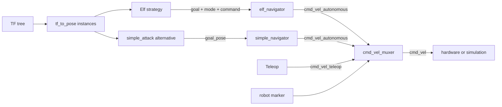

# combat_strategizer

[Package index](README.md) · [System architecture](../architecture.md)

Elf selects maneuvers. The drive mux chooses between autonomous and teleop commands. The package also provides direct-pursuit and Nav2 examples.

## Nodes

### elf_combat_strategizer — default strategy

[Source: ElfCombatStrategizer](../../src/combat_strategizer/combat_strategizer/elf_combat_strategizer.py). Executable and node name: `elf_combat_strategizer`.

| Direction | Topic | Type | Contract |
| --- | --- | --- | --- |
| Subscribe | /autonomy | std_msgs/Bool | Initial false; enables strategy. |
| Subscribe | /robot/pose | geometry_msgs/PoseStamped | Robot x/y/yaw; reception time determines validity. |
| Subscribe | /opponent/pose | geometry_msgs/PoseStamped | Cached target, without a freshness timeout. |
| Publish | /goal_pose | geometry_msgs/PoseStamped | Attack copies opponent header/pose; defense creates a map-frame point. |
| Publish | /drive_mode | std_msgs/String | FORWARD for attack, BACKWARD for defense. |
| Publish | /elf_navigator_cmd | std_msgs/String | STOP or BACKWARD:<speed>. |

A 0.05 s timer runs the state machine. Pose/proximity/recovery timing uses `time.time()`, while ROS headers use the node clock. Goal completion is inferred from position, not action feedback.

| State | Behavior and transitions |
| --- | --- |
| IDLE | Repeated STOP. Enabled autonomy and a robot pose received less than 2 s ago allow ATTACK. All states return to IDLE when either check fails. |
| ATTACK | Repeated opponent goal and FORWARD; missing opponent causes STOP. Continuous distance ≤0.2 m for 5 s triggers DEFENSE. Otherwise, being within 0.2 m of a wall and facing outward triggers WALLRECOVERY. |
| DEFENSE | Select once the farthest of four points around arena center, relative to opponent. Repeated goal and BACKWARD until within 0.1 m, then ATTACK. |
| WALLRECOVERY | STOP on entry, then one BACKWARD:0.5 message. Wait distance/speed (1/0.5 = 2 s), STOP, return to ATTACK. There is no active turn phase. |

Source defaults: `arena_width=arena_height=1.5`, `center_x=center_y=0.75`, `wall_threshold=0.2`, `escape_offset=0.2`, `proximity_radius=0.2`, `proximity_duration=5.0`, `robot_pose_timeout=2.0`, `backward_speed=0.5`, `escape_reached_threshold=0.1`, `wall_recovery_backward_distance=1.0`. `turn_speed=1.0` and `turn_tolerance=0.05` are loaded but unused by an active turn maneuver. Distances are metres, durations seconds, angles radians. Arena bounds assume x/y start at zero. No frame conversion is performed.

**Improve:** Check the original observation time for both robot and opponent.

### cmd_vel_muxer — shared drive arbitration

[Source](../../src/combat_strategizer/combat_strategizer/cmd_vel_muxer.py). Executable/node `cmd_vel_muxer`; bringup renames it `robot_cmd_vel_muxer`.

Subscribes to relative `cmd_vel_teleop` and `cmd_vel_autonomous` (`geometry_msgs/Twist`), and `arena_perception/robot/visible_marker` (`std_msgs/String`). Publishes relative `cmd_vel` (`geometry_msgs/Twist`) at 20 Hz. Teleop, including zero commands, wins for `teleop_timeout=0.5` s. Otherwise the last autonomous message persists indefinitely; no received command means zero. There is no subscription to `/autonomy`.

Marker `bottom` activates configured inversions: `invert_linear_x=true`, `invert_linear_y=false`, `invert_angular_z=false`. Marker `none` preserves the previous value. Initial effective marker is None. Other Twist components are copied unchanged.

**Improve:** Expire autonomous commands and make timed reverse renewable.

### simple_attack — forward the opponent pose as a goal

[Source](../../src/combat_strategizer/combat_strategizer/simple_attack.py). Callback-driven subscription to `/opponent/pose` and publication of the unchanged `geometry_msgs/PoseStamped` on `/goal_pose`.

**Improve:** Reject stale targets before forwarding them.

### nav2_attack — optional inherited strategy

[Source](../../src/combat_strategizer/combat_strategizer/nav2_attack.py). Executable `nav2_attack` instantiates `Nav2Attack` but inherits node name `nav2_navigator`. It inherits the robot-pose subscription, direct `/cmd_vel` output, 10 Hz alignment loop, parameters and `navigate_to_pose` action client described in [robot_navigation](robot_navigation.md). The wrapper's standalone `/attack_command` and `/escape_command` subscriptions are created in its `main()`, so are **not** inherited here.

Additional input: `/arena_perception_opponent_base_footprint_pose` (`geometry_msgs/PoseStamped`). The `/defense_position` subscription is commented out. Every 0.5 s it selects the farthest of four positions offset 0.3 m from (0.75, 0.75). During ATTACK, opponent motion ≥0.01 m triggers a new attack/alignment. A separate 0.1 s loop runs ATTACK → DEFENCE → STANDBY → ATTACK. Its local proximity condition requires distance ≤0.23 m continuously for 5 s. Defense calls `escape()`, then starts a **10 s** dwell once inherited navigation state equals the string IDLE. Any completed action result sets IDLE, irrespective of success.

`combat_state` uses the local `State` enum; inherited `state` normally uses strings but is initially overwritten with `CombatState.ATTACK`. The locally defined `ProximityCondition` shadows the imported class.

**Improve:** Distinguish successful arrival from cancellation or failure before starting the defense dwell.

### tf_to_pose — TF adapter

[Source](../../src/combat_strategizer/combat_strategizer/tf_to_pose.py). Parameters: required nonempty `source_frame` (default empty), `reference_frame=world`, `pose_topic=pose`, `rate=60.0` Hz. Looks up latest reference → source TF and publishes `geometry_msgs/PoseStamped` on the configured topic. Output stamp is **now**, not the transform timestamp; lookup errors are silently ignored. Both perception modes adapt `robot/base_footprint` to `/robot/pose`. Camera perception adapts `opponent` to `/opponent/pose`; fake perception instead reads `arena_perception/opponent/base_footprint`.

**Improve:** Preserve the TF stamp and skip stale transforms.

### point_to_pose_remap — alternative point-only adapter

[Source](../../src/combat_strategizer/combat_strategizer/point_to_pose_remap.py). Subscribe `geometry_msgs/PointStamped` at `input_topic=/detected_opponent/viz_point`; publish `geometry_msgs/PoseStamped` at `output_topic=/opponent/pose` on each callback. Copies header and x/y, forces z=0 and identity orientation. This does not provide measured heading and is an alternative to the opponent TF adapter.

**Improve:** Specify how consumers should interpret identity orientation.

### weapon_control — optional distance policy

[Source: WeaponSpeedController](../../src/combat_strategizer/combat_strategizer/weapon_control.py).

| Direction | Relative topic | Type | Contract |
| --- | --- | --- | --- |
| Subscribe | goal_pose | geometry_msgs/PoseStamped | Cached goal; header discarded. |
| Subscribe | camera/pose | geometry_msgs/PoseStamped | Cached robot pose; differs from default /robot/pose. |
| Subscribe | weapon/armed | std_msgs/Bool | Local gate; initially false. |
| Publish | weapon/speed | std_msgs/Float32 | Speed request at 10 Hz. |

With `distance_threshold=0.41` m, output is 0 when disarmed, 0.69 when armed and within the threshold, otherwise 0.1. Distance is 3D. Missing poses yield infinite distance and therefore **0.1 when armed**. The local arm topic does not gate the independent slider or serial bridge.

**Improve:** Require fresh robot and goal poses before requesting weapon speed.

### conditions/ and states.py — Python APIs, not nodes

[Sources](../../src/combat_strategizer/combat_strategizer/conditions). [BaseCondition](../../src/combat_strategizer/combat_strategizer/conditions/base_condition.py) defines `update(**kwargs)`, `is_triggered()` and `reset()`. [NavDoneCondition](../../src/combat_strategizer/combat_strategizer/conditions/nav_done_condition.py) inverts goal-in-progress; [TimeoutCondition](../../src/combat_strategizer/combat_strategizer/conditions/timeout_condition.py) compares elapsed time; library [ProximityCondition](../../src/combat_strategizer/combat_strategizer/conditions/proximity_condition.py) accumulates supplied dt while close but does not clear it when separated. Nav2Attack instead uses its shadowing local class with `check(robot_pose, opponent_pose)` and continuous wall-clock proximity. Elf implements separate checks. `states.py` defines another CombatState enum.

**Improve:** select accumulated versus continuous proximity explicitly, unify the condition protocol, and test reset/missing-data/state-transition cases.

## Package wiring

[elf_autonomy.launch.py](../../src/combat_strategizer/launch/elf_autonomy.launch.py) starts only Elf strategy and `robot_navigation/elf_navigator`. Bringup supplies the mux; perception supplies pose adapters. The launch does not propagate `use_sim_time`.

[rhino_autonomy.launch.py](../../src/combat_strategizer/launch/rhino_autonomy.launch.py) selects `simple_attack` + `robot_navigation/simple_navigator` + `weapon_control`. It neither loads the simple navigator YAML nor remaps `camera/pose`. Nav2Attack is a separately started third alternative. These strategies/controllers compete if launched together.

## Package improvements

- Provide explicit mutually exclusive strategy compositions with consistent clocks and command ownership.
- Separate pose adaptation and actuation arbitration from strategy selection; expose strategy status.
- Declare direct runtime dependencies, including `std_msgs` and `robot_navigation`, and add behavioral checks beyond existing linter scaffolding.
