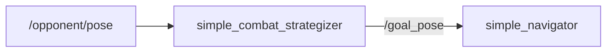
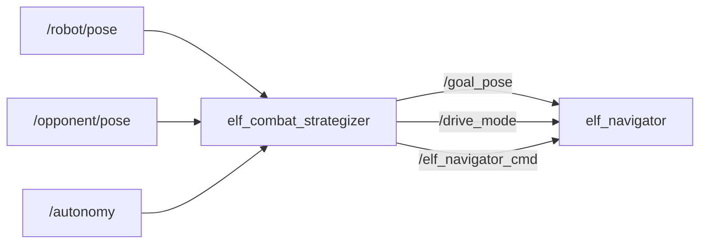
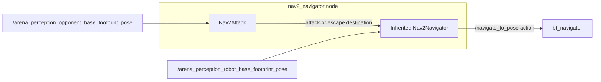

# combat_strategizer

The combat strategizer decides where to go and how to approach. It provides this information to the navigator that
turns that decision into motion. This package also provides pose adapters.
[Autonomy overview](../autonomy.md) · [Navigator guide](robot_navigation.md)

## Variants

There are different variants of combat strategizers available:

| Strategizer | Role | How it chooses a maneuver |
| --- | --- | --- |
| `simple_combat_strategizer` | Original direct-pursuit example | Makes the opponent's latest pose the goal. |
| `elf_combat_strategizer` | Default | Uses a state machine for pursuit, retreat, and wall recovery. |
| `nav2_attack` | Optional Nav2 example | Chooses attack and retreat destinations for a Nav2 action client. |

## simple_combat_strategizer

`simple_combat_strategizer` forwards each `/opponent/pose` message unchanged
to `/goal_pose`. Both topics use `geometry_msgs/msg/PoseStamped`.
`simple_navigator` combines that goal with `/robot/pose` and starts steering as
soon as both are available. This gives a baseline where every new opponent
observation becomes the next target.
[Strategizer source](../../src/combat_strategizer/combat_strategizer/simple_combat_strategizer.py)

### Proposed improvement

- Reject stale targets before forwarding them.

## elf_combat_strategizer

`elf_combat_strategizer` reads `/robot/pose` and `/opponent/pose` and runs its
state machine at 20 Hz. It starts with `/autonomy` disabled. Pursuit and retreat use
a goal plus a drive direction. An immediate command interrupts goal tracking
to stop or reverse during wall recovery.
[Strategizer source](../../src/combat_strategizer/combat_strategizer/elf_combat_strategizer.py)

| Interface | Type | Purpose |
| --- | --- | --- |
| `/autonomy` | `std_msgs/msg/Bool` | Enables the strategy when a recent robot pose is available. |
| `/robot/pose`, `/opponent/pose` | `geometry_msgs/msg/PoseStamped` | Self pose and opponent target. |
| `/goal_pose` | `geometry_msgs/msg/PoseStamped` | Opponent pose in attack or a point in `map` during defense. |
| `/drive_mode` | `std_msgs/msg/String` | `FORWARD` for attack, `BACKWARD` for defense. |
| `/elf_navigator_cmd` | `std_msgs/msg/String` | `STOP` or `BACKWARD:<speed>` for immediate motion control. |

### State machine

| State | What Elf does |
| --- | --- |
| `IDLE` | Sends `STOP`. Enters `ATTACK` when autonomy is enabled and a robot pose was received less than 2 seconds ago. Disabling autonomy or losing robot pose updates returns Elf to `IDLE` from any state. |
| `ATTACK` | Sends the opponent pose and `FORWARD`. With no opponent pose it commands a stop. Staying within 0.2 m for 5 seconds triggers `DEFENSE`. Near a wall and facing outward, Elf can enter `WALLRECOVERY`. |
| `DEFENSE` | Chooses the farthest of four points near the arena center, measured from the opponent. Sends that goal with `BACKWARD` until the robot is within 0.1 m, then resumes attack. |
| `WALLRECOVERY` | Sends `STOP` on entry, then sends `BACKWARD:0.5` once. After 2 seconds at the default settings it sends `STOP` and resumes attack. |

The defaults assume a 1.5 m × 1.5 m arena starting at (0, 0), with a 0.2 m wall
threshold and escape points 0.2 m from the center. Recovery time is
`wall_recovery_backward_distance / backward_speed`, using defaults of 1.0 m
and 0.5 m/s. Pose reception, proximity, and recovery use wall-clock time.
The robot-pose timeout measures time since the last message arrived. Elf
keeps the last opponent pose without an expiry.

### Proposed improvement

- Check the original observation time for both robot and opponent.

## nav2_attack

`nav2_attack` is an optional example that inherits the `Nav2Navigator` class.
It runs under the node name `nav2_navigator`, uses the legacy robot and
opponent pose topics, and calls `attack()` and `escape()` within the same
node. The inherited wrapper aligns the robot before sending the destination
to `bt_navigator` on `/navigate_to_pose`.
[Strategizer source](../../src/combat_strategizer/combat_strategizer/nav2_attack.py) · [nav2_navigator](robot_navigation.md#nav2_navigator)

During attack, an opponent position change of at least 0.01 m triggers a new
goal. Staying within 0.23 m for 5 seconds triggers `DEFENCE`, which selects a
point near the arena center away from the opponent. When the navigation
wrapper returns to `IDLE`, the strategy starts its 10-second dwell before
returning to attack through `STANDBY`. The wrapper also returns to `IDLE` on
rejection or failure, so the dwell can start without reaching the goal.

### Proposed improvement

- Distinguish successful arrival from cancellation or failure before starting
  the defense dwell.

## Pose adapters and helpers

| Component | Purpose |
| --- | --- |
| [`tf_to_pose`](../../src/combat_strategizer/combat_strategizer/tf_to_pose.py) | Publishes the latest TF pose as `PoseStamped`, stamping the message with the current ROS time. Defaults to the `world` reference frame and 60 Hz. |
| [`point_to_pose_remap`](../../src/combat_strategizer/combat_strategizer/point_to_pose_remap.py) | Converts `/detected_opponent/viz_point` to `/opponent/pose`. It preserves x and y, sets z to zero, and uses an identity orientation. |
| [`conditions/`](../../src/combat_strategizer/combat_strategizer/conditions) and [`states.py`](../../src/combat_strategizer/combat_strategizer/states.py) | Python helpers for proximity, timeouts, navigation completion, and combat states. Elf and Nav2Attack implement their active proximity checks separately. |

### Proposed improvements

- **`tf_to_pose`**. Preserve the TF stamp and skip stale transforms.
- **`point_to_pose_remap`**. Specify how consumers should interpret identity
  orientation.
- **`conditions/` and `states.py`**. Select accumulated versus continuous
  proximity explicitly, unify the condition protocol, and test resets,
  missing data, and state transitions.

## Package improvements

- Provide explicit mutually exclusive strategy compositions with consistent
  clocks and command ownership.
- Separate pose adaptation from strategy selection and expose strategy status.
- Declare direct runtime dependencies, including `std_msgs` and
  `robot_navigation`, and add behavioral checks beyond existing linter
  scaffolding.
