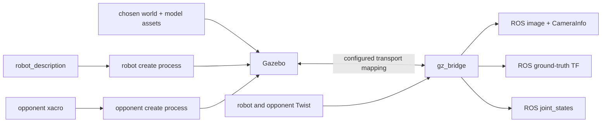

# robofetz_gazebo

[Package index](README.md) · [System architecture](../architecture.md)

Spawns the robot and opponent in Gazebo and bridges their commands, camera data and ground truth to ROS.

## Optional helpers

### camera_info_publisher

[Source](../../src/robofetz_gazebo/robofetz_gazebo/camera_info_publisher.py). Requires `config_file` (default empty; throws when absent). Subscribes to `image_topic=/arena_camera/image` (`sensor_msgs/Image`, depth 10); publishes relative `camera_info` (`sensor_msgs/CameraInfo`, depth 10). Reads image dimensions, distortion model and K/D/R/P from YAML. On each new image timestamp it copies image stamp/frame and emits fixed calibration, with zero binning/ROI. Duplicate timestamps are suppressed. No timer/service/action.

The default bridge already supplies CameraInfo.

**Improve:** validate YAML matrices against actual image dimensions and avoid two CameraInfo authorities; make the output topic explicit.

### grayscale_republisher

[Source: GrayscaleRepublisher](../../src/robofetz_gazebo/robofetz_gazebo/grayscale_republisher_node.py). Executable `grayscale_republisher`, node `grayscale_republisher`. Subscribes to relative `arena_camera/image_sim_color` and publishes `arena_camera/image_raw`, both `sensor_msgs/Image`, depth 10. Converts bgr8 to mono8 and preserves the header. Callback-driven; topics are hard-coded, no custom parameters. Not selected by current simulation launch, whose bridge uses `arena_camera/image`.

**Improve:** parameterize/remap image endpoints, keep color available for the active color detector, and remove or explicitly label unused conversion profiles.

### tf_to_pose

[Source: TFToPoseStamped](../../src/robofetz_gazebo/robofetz_gazebo/tf_to_pose.py). Executable `tf_to_pose`, node `tf_to_pose_stamped`. Requires `parent_frame`, `child_frame` and `pose_topic`; `publish_rate=10.0` Hz. Uses latest TF with lookup timeout 0.1 s; publishes `geometry_msgs/PoseStamped`, depth 10, copying the **transform header**. Lookup failures produce throttled warnings.

Not used in current launch. It is an alternative to combat_strategizer's similarly named adapter; that adapter instead restamps with now and defaults to 60 Hz.

**Improve:** consolidate the adapters around original timestamps and explicit freshness; validate nonempty frames/topics and positive rate.

### generate_checkerboard_sdf.py — offline utility

[Source](../../src/robofetz_gazebo/scripts/generate_checkerboard_sdf.py). Not a console script or ROS node. CLI arguments: rows, columns, optional square size (default 0.0254 m), optional border (default half square size). Creates a new named directory containing `checkerboard.sdf` and `model.config`, aborting if that directory already exists.

**Improve:** validate positive dimensions and expose an output directory; keep generated calibration geometry/version paired with camera calibration records.

## External processes and bridge interfaces

[robofetz_gazebo_sim.launch.py](../../src/robofetz_gazebo/launch/robofetz_gazebo_sim.launch.py) starts `gz sim -r -v 4`, configures model-search paths, optionally includes robot_description, spawns two models with `ros_gz_sim/create`, and starts `ros_gz_bridge/parameter_bridge` as `gz_bridge`.

Arguments: `world=robofetz_arena_wideangle.world` and `enable_robot_state_pub=true`. Root bringup overrides the world to pinhole and disables the duplicate robot state publisher. Internal timers: description +2 s, spawning +5 s, bridge +6 s, measured from this included launch's start. Robot spawn pose is (0.3,1.2,0), yaw -0.78; opponent (1.2,0.3,0), yaw 2.36. Robot spawn consumes /robot_description; opponent xacro is expanded and supplied as a string.

[bridge_parameters.yaml](../../src/robofetz_gazebo/parameters/bridge_parameters.yaml) enables these endpoints (root namespace):

| Direction | ROS topic/type | Gazebo topic/type |
| --- | --- | --- |
| GZ → ROS | /clock — rosgraph_msgs/Clock | clock — gz.msgs.Clock |
| ROS → GZ | /cmd_vel — geometry_msgs/Twist | robot/cmd_vel — gz.msgs.Twist |
| GZ → ROS | /joint_states — sensor_msgs/JointState | robot/joint_states — gz.msgs.Model |
| GZ → ROS | /tf — tf2_msgs/TFMessage | robot/pose_ground_truth — gz.msgs.Pose_V |
| ROS → GZ | /opponent/cmd_vel — geometry_msgs/Twist | opponent/cmd_vel — gz.msgs.Twist |
| GZ → ROS | /tf — tf2_msgs/TFMessage | opponent/pose_ground_truth — gz.msgs.Pose_V |
| GZ → ROS | /arena_camera/image — sensor_msgs/Image | arena_camera/image — gz.msgs.Image |
| GZ → ROS | /arena_camera/camera_info — sensor_msgs/CameraInfo | arena_camera/camera_info — gz.msgs.CameraInfo |

Wheel odometry/slip TF and additional ground-truth odometry mappings in the file are commented out. No weapon topic is bridged. Spawning uses Gazebo’s external create process.

**Improve:** verify bridge types/QoS against installed dependencies; replace spawn timers with readiness; make wheel-feedback and weapon support explicit rather than inferred from model plugins.

## Models and variants

Both worlds include a 1.5 m square arena, fixed arena tag and checkerboard. Pinhole additionally includes the ball. Camera pose is (0.75,0.75,1.0), pitched downward. Pinhole: 800×600, horizontal FOV 1.689 rad, 30 Hz. Wide-angle: 800×600, FOV 2.2689 rad, 60 Hz, equidistant lens; it also retains ignition-era sensor plugin naming. Different optical models/calibrations are **alternatives**, not simultaneous sensors. YAML camera profiles are installed but the default launch uses bridged simulator calibration.

The [opponent model](../../src/robofetz_gazebo/models/simple_diff_drive_opponent/simple_diff_drive_opponent.xacro) and its [Gazebo extension](../../src/robofetz_gazebo/models/simple_diff_drive_opponent/simple_diff_drive_opponent.gazebo) provide DiffDrive on opponent/cmd_vel, wheel odometry/slip TF at 30 Hz, and ground-truth world → opponent/base_footprint_sim at 60 Hz. Only command and ground-truth TF are bridged. Main-robot plugins live in [robot_description](robot_description.md).

**Improve:** verify optical calibration/frame conventions per world, align both worlds with the supported Gazebo version, and parameterize common arena dimensions/spawn geometry.

## Package wiring

The helper Python nodes are optional utilities, not stages in this active bridge graph. Fake perception consumes ground-truth TF via arena_perception relays; camera perception consumes the rendered image pair. Ground truth remains in *_sim frames, separate from estimated robot TF.

## Package improvements

- Make repeatable camera/fake-perception profiles with declared clock and readiness contracts.
- Add headless integration cases comparing estimates to ground truth, including dropped camera updates and flipped robot poses.
- Complete runtime dependencies (for example ros_gz_sim and robot_description), check installed model assets, and retire or label unused helpers deliberately.
