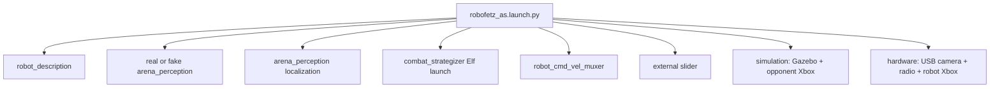

# robot_bringup

[Package index](README.md) · [System architecture](../architecture.md)

Starts the simulation or hardware stack. Provides `robot_cmd_vel_muxer`, the serial radio
bridge, and an optional keyboard driver for the simulated opponent.

## Nodes

### robot_cmd_vel_muxer

The `cmd_vel_muxer` executable runs as `robot_cmd_vel_muxer` in standard
bringup. It publishes `/cmd_vel` at 20 Hz. A command on `/cmd_vel_teleop`,
including zero velocity, takes priority for 0.5 seconds by default.
Afterward, the node repeats the last `/cmd_vel_autonomous` message until a new
one arrives. It has no autonomous command timeout, so a one-shot wall
recovery command can persist if the strategizer stops before sending
`STOP`. The `bottom` marker on `/arena_perception/robot/visible_marker`
reverses linear x by default. A `none` marker preserves the last known
orientation.
[Node source](../../src/robot_bringup/robot_bringup/cmd_vel_muxer.py)

In simulation, `ros2 node info /robot_cmd_vel_muxer` should show both velocity
inputs and the `/cmd_vel` publisher.

#### Proposed improvement

- Expire autonomous commands and make timed reverse renewable.

### radio_bridge_node

[Source: RadioBridgeNode in transmitter.py](../../src/robot_bringup/robot_bringup/transmitter.py). Selected only by hardware bringup. Opens serial immediately during construction: `serial_port=/dev/ttyUSB0`, `baud_rate=115200`, read timeout 0.1 s. Requires Python serial support.

| Input topic | Type | Serial output |
| --- | --- | --- |
| /cmd_vel | geometry_msgs/Twist | `CMD:linear.x,angular.z\n` |
| /weapon/speed | std_msgs/Float32 | `WPN:data\n` |
| /drive/pid_tuning | std_msgs/Float64MultiArray | `PID:p,i,d,f\n` from first four elements; fewer than four ignored. |

All subscriptions use depth 10. Numbers are formatted to two decimal places. Drive fields are m/s and rad/s; weapon is the firmware's normalized request. No range/finite checks, ownership, arming, acknowledgement, resend timer or command expiry are implemented. A daemon receive thread logs text from ESP32; it publishes **no ROS telemetry or odometry**. Serial opening/writes are not recovered automatically. The radio firmware consumes CMD/WPN but does not implement the transmitted PID command; see [firmware](../firmware.md).

**Improve:** Validate serial fields and expose connection state.

### keyboard_node

[Source: EnemyTeleop](../../src/robot_bringup/robot_bringup/keyboard_node.py). Executable `keyboard_node`, node `enemy_teleop_node`. Publishes `geometry_msgs/Twist` on `/opponent/cmd_vel`, depth 10. A nominal 0.1 s timer polls terminal keys and republishes the retained command: arrows/WASD select ±0.5 m/s or ±1 rad/s, space stops, Q quits. Terminal reads can block for 0.1 s each, so the timer is not a strict output-rate guarantee. Shutdown attempts a zero command. No parameters, subscriptions, services or actions. Uses POSIX termios/tty and is not started by the default simulation launch.

**Improve:** Expire keyboard commands when input stops.

## Launched external components

| Launch/config | Interface and role |
| --- | --- |
| [xbox_teleop.launch.py](../../src/robot_bringup/launch/xbox_teleop.launch.py) | Includes the external `teleop_twist_joy` launch with `joy_vel=cmd_vel_teleop`. Joystick input becomes a Twist for `robot_cmd_vel_muxer`. |
| [teleop_opponent.launch.py](../../src/robot_bringup/launch/teleop_opponent.launch.py) | Sets `joy_vel=opponent/cmd_vel` so the operator can drive the Gazebo opponent with the Xbox controller while testing the robot’s autonomy. |
| [xbox_teleop.config.yaml](../../src/robot_bringup/config/xbox_teleop.config.yaml) | Linear x axis 1, yaw axis 0; normal/turbo scales both 1.2 m/s and 5 rad/s; enable button 2, turbo button 5. |
| [weaponspeed_slider.launch](../../src/robot_bringup/launch/weaponspeed_slider.launch) | Starts the external `slider_publisher` using `Float32.yaml`. It publishes `/weapon/speed` with a range of 0–1 and a default of 0. |
| [config.rviz](../../src/robot_bringup/config/config.rviz) | Optional RViz visualization configuration; not a control node. |

See [slider_publisher](slider_publisher.md) for the GUI interface.

**Improve:** make teleop selection explicit, publish operator enable/ownership state, and route the slider through a common weapon authority. A headless option must suppress slider and perception GUI, not just RViz.

## Package wiring

[robofetz_as.launch.py](../../src/robot_bringup/launch/robofetz_as.launch.py) is the system entry point. It orchestrates packages rather than providing its own control algorithm.

| Argument | Default / effect |
| --- | --- |
| use_sim | true; Gazebo versus serial radio + USB camera + robot Xbox teleop |
| use_fake_perception | false; substitutes ground-truth relays for camera perception; simulation-only requirement is described but not enforced |
| world | robofetz_arena_pinhole.world; also allows robofetz_arena_wideangle.world |
| launch_rviz | true; only controls RViz |
| rviz_config | config.rviz |
| arena_perception_config | arena_perception/config/arena_perception_config.yaml |
| robot_localization_config | arena_perception/config/robot_localization_config.yaml |

Always starts robot_state_publisher with frame prefix robot/, `robot_cmd_vel_muxer` and the weapon slider. Simulation selects Gazebo and opponent Xbox teleop. Hardware selects radio_bridge_node, USB camera and robot Xbox teleop. Real/fake perception selection is independent of use_sim. Localization runs in both modes, and Elf is always the selected autonomy composition, initially disabled by its /autonomy state.

Root timers, relative to launch start: Gazebo 3 s; perception 8 s simulation / 3 s hardware; localization 20/15 s; RViz 25/20 s; Elf 30 s. Included launches add further delays. There is no readiness handshake. Root computes run_rectification and passes it to perception, but perception does not consume it and always launches rectification.

## Package improvements

- Replace fixed delays with camera/TF/controller readiness and reject invalid mode combinations.
- Provide explicit strategy, teleop, camera and headless profiles; propagate serial/camera settings and clocks.
- Declare the remaining runtime dependencies in `package.xml` and add
  launch-composition validation without opening hardware.
