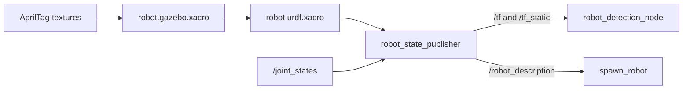

# robot_description

[Package index](README.md) · [System architecture](../architecture.md)

The URDF defines the robot geometry, tag mounts and Gazebo plugins.

## robot_state_publisher

[robot_state_publisher.launch.py](../../src/robot_description/launch/robot_state_publisher.launch.py) processes [robot.urdf.xacro](../../src/robot_description/urdf/robot.urdf.xacro) in Python and starts the external `robot_state_publisher/robot_state_publisher` node. Arguments: `use_sim_time=false` and `prefix=''`. Bringup supplies `prefix=robot/`. The xacro is processed without a link-name prefix; the ROS node's `frame_prefix` adds it to TF. `publish_frequency=50.0` is configured.

`robot_state_publisher` gets the URDF from the `robot_description` parameter.
`spawn_robot` consumes the published `/robot_description` topic.
`robot_state_publisher` reads `/joint_states` (`sensor_msgs/JointState`) for
moving joints and publishes transforms on `/tf` and `/tf_static`
(`tf2_msgs/TFMessage`).

**Improve**

- Check expanded URDF, frame names and joint-state names in each launch profile.
- Make prefix behavior consistent across ROS frames, model names and Gazebo plugin topics; a frame prefix alone does not namespace plugin outputs.

## Geometry and frame interface

| Parent → child (prefix robot/ in default TF) | Relationship |
| --- | --- |
| base_footprint → body_link | Fixed x=-0.02575 m (property is named baseframe_offset_y but used on x). |
| body_link → top_apriltag_link → top_apriltag_optical | Fixed mounting; optical rotation relative to link is roll=0, pitch=pi, yaw=pi/2. |
| body_link → bottom_apriltag_link → bottom_apriltag_optical | Bottom link has roll=pi; optical link adds yaw=pi/2. |
| body_link → right_wheel_link / left_wheel_link | Continuous wheel joints, rotation axis y. |
| body_link → weapon_link | **Fixed** weapon_joint; no spinning actuator is implemented. |
| body_link → front_left_support_link / front_right_support_link | Fixed supports, each with fixed top/bottom caster links. |

Body dimensions are 0.0969 × 0.147 × 0.065 m; wheel radius 0.0355 m, width 0.01 m, wheel separation 0.167 m. Link masses/inertias are computed from dimensions and density properties. The visual tag surface is 0.094 m square; perception's detected tag edge is separately configured as 0.0522 m. These are different quantities that require calibration validation, not an automatic assumption of equality.

`robot_detection_node` queries the transforms from the tag optical frames to
`robot/base_footprint`, so tag orientation and offsets affect localization.

**Improve**

- Name geometric offsets by their actual axis and document physical printed-edge versus visual-board dimensions.
- Verify top/bottom mounting transforms with known poses, including the inverted robot.
- Reconcile model wheel geometry with firmware constants before using odometry for fusion.

## Gazebo plugin interfaces

[robot.gazebo.xacro](../../src/robot_description/urdf/gazebo/robot.gazebo.xacro) adds materials/contact settings and these Gazebo systems. Names in this table are Gazebo transport names; [robofetz_gazebo](robofetz_gazebo.md) decides which are bridged to ROS.

| Plugin | Inputs/outputs |
| --- | --- |
| gz::sim::systems::DiffDrive | Input robot/cmd_vel (gz.msgs.Twist); configured odom robot/wheel_odometry and TF robot/pose_with_slip, 30 Hz; frames robot/odom → robot/base_footprint; max_linear_acceleration=10. |
| gz::sim::systems::JointStatePublisher | Output robot/joint_states, right_wheel_joint and left_wheel_joint. |
| gz::sim::systems::OdometryPublisher | Ground-truth outputs robot/odometry_ground_truth, robot/odometry_ground_truth_with_covariance and robot/pose_ground_truth at 60 Hz; world → robot/base_footprint_sim; dimensions=3. |

The current bridge enables drive commands, wheel joint states and ground-truth
TF. The weapon is fixed geometry in the simulation.

**Improve**

- Add explicit actuator/weapon simulation only when required, with a matching ROS bridge contract.
- Keep ground truth separate from estimated localization and choose one owner for each TF edge.
- Validate plugin topic/frame names against generated model names and bridge YAML.

## Package wiring

It provides robot-relative geometry only; world/map/odom and camera relationships belong to perception/localization.

## Package improvements

- Establish one source for physical dimensions/tag mounts across URDF, perception and firmware.
- Add offline xacro/TF-tree consistency checks and installed-asset checks.
- Separate simulation-specific plugin settings from reusable physical geometry, keeping current launch interfaces explicit.
