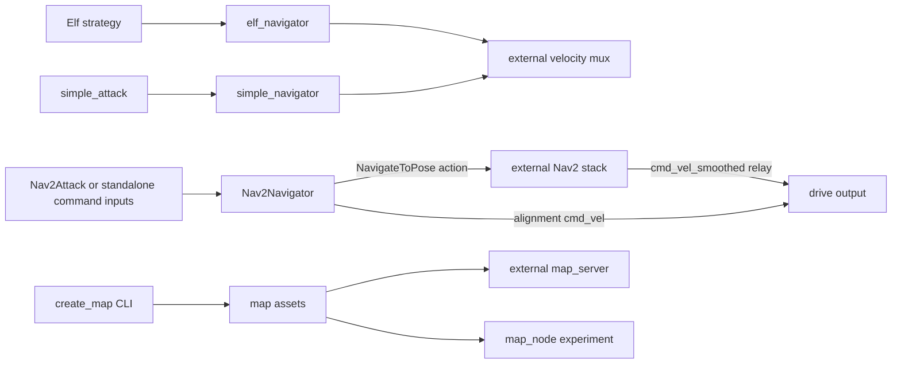

# robot_navigation

[Package index](README.md) · [System architecture](../architecture.md)

Provides the Elf and direct-pursuit controllers, a Nav2 action client and two map tools.

## Nodes

### elf_navigator — default reactive controller

[Source: ElfNavigator](../../src/robot_navigation/robot_navigation/elf_navigator.py).

| Direction | Topic | Type | Contract |
| --- | --- | --- | --- |
| Subscribe | /robot/pose | geometry_msgs/PoseStamped | Cached x/y/yaw, no input-age or frame validation. |
| Subscribe | /goal_pose | geometry_msgs/PoseStamped | Enables tracking and resets yaw integral on every message. |
| Subscribe | /drive_mode | std_msgs/String | Uppercased; FORWARD selects forward control, every other value follows backward branch. |
| Subscribe | /elf_navigator_cmd | std_msgs/String | Immediate command, cancels tracking and clears the goal. |
| Publish | /cmd_vel_autonomous | geometry_msgs/Twist | Linear x in m/s, angular z in rad/s. |

The 20 Hz tracking loop uses distance-proportional linear control and PI yaw control. For backward tracking it offsets yaw error by pi. Linear speed is scaled by `max(0.3, 1-abs(yaw_error)/pi)`, so large yaw error does **not** prevent translation. Within `position_tolerance` it publishes zero once and disables tracking. Missing poses/goals or inactive tracking cause no output, not repeated zero. It compares coordinates directly and ignores goal orientation.

Immediate strings: `STOP`, `FORWARD[:speed]`, `BACKWARD[:speed]`, `TURN[:angular]`, `TURN_LEFT[:speed]`, `TURN_RIGHT[:speed]`. A command publishes **once**, with no duration or completion feedback. Invalid numeric text is not caught; unknown actions clear tracking before returning without a replacement command. Default mux behavior is what retains one-shot motion.

| Parameters | Source defaults |
| --- | --- |
| Immediate command speeds | default_linear_speed=0.3, default_angular_speed=3.0 |
| Tracking caps | forward_speed=3.0, backward_speed=3.0, turn_speed=3.5 |
| Tracking gains | linear_kp=1.0, angular_kp=1.8, angular_ki=0.5, integral_windup_limit=2.0 |
| Tolerance | position_tolerance=0.1 |
| Loaded but not used in control | angle_threshold_for_driving=0.17 |

**Improve:** Reject malformed commands and stop when inputs expire.

### simple_navigator — forward-only goal tracking

[Source: SimpleBotNavigator](../../src/robot_navigation/robot_navigation/simple_navigator.py). Executable `simple_navigator`; source node name `battle_bot_navigator`, renamed `simple_navigator` by launch.

Subscribes to `/robot/pose` and `/goal_pose` (`geometry_msgs/PoseStamped`), publishes `/cmd_vel_autonomous` (`geometry_msgs/Twist`) at 30 Hz when inputs exist. Only forward tracking is implemented. PI yaw control and distance/angle-based speed adjustment run until position tolerance; then it keeps publishing zero. Each goal resets the integral. Missing input returns without a stop. For differing frames it requests TF but **never applies the returned transform**; subtraction still uses original coordinates. TF exceptions publish zero, other exceptions only log.

Source defaults: `linear_kp=0.5`, `angular_kp=1.8`, `angular_ki=0.5`, `max_linear=1.0`, `max_angular=3.5`, `position_tolerance=0.1`, `orientation_tolerance=0.3`, `goal_frame=map`, `integral_windup_limit=2.0`, `min_speed=0.3`, `angle_threshold_for_driving=0.5`, `distance_to_slow_down=0.1`. Orientation tolerance, goal_frame and angle threshold do not enforce final orientation/frame conversion/driving gating. The runtime parameter callback reloads current stored parameters during the pre-set callback rather than explicitly applying proposed values.

[simple_nav.launch.py](../../src/robot_navigation/launch/simple_nav.launch.py) loads [simple_navigator_config.yaml](../../src/robot_navigation/config/simple_navigator_config.yaml): lower caps/gains, including max_linear=0.1, linear_kp=0.2, angular_kp=1.0, angular_ki=0.05 and position_tolerance=0.05. The launch that pairs this controller with `simple_attack` constructs the node with its source defaults.

**Improve:** Apply the transform before computing position error.

### nav2_navigator — optional alignment/action wrapper

[Source: Nav2Navigator](../../src/robot_navigation/robot_navigation/nav2_navigator.py). Executable/node `nav2_navigator`, also the base class used by `combat_strategizer/nav2_attack`.

| Direction | Name | Type | Contract |
| --- | --- | --- | --- |
| Subscribe | /arena_perception_robot_base_footprint_pose | geometry_msgs/PoseStamped | Stores pose only, losing frame/stamp. |
| Subscribe in standalone main only | /attack_command | geometry_msgs/PoseStamped | Calls attack(target). |
| Subscribe in standalone main only | /escape_command | geometry_msgs/PoseStamped | Threat to face; safe destination hard-coded to (0,0). |
| Publish | /cmd_vel | geometry_msgs/Twist | Direct alignment commands, bypasses mux. |
| Action client | navigate_to_pose (relative) | nav2_msgs/action/NavigateToPose | Sends goal.pose; does not consume feedback; result callback ignores result status. |

`attack(opponent_pose)` asynchronously cancels a known old goal, aligns toward the opponent, then sends its position to Nav2. `escape(opponent_pose, safe_pose)` aligns toward the threat before navigating to safety. The 10 Hz alignment loop uses PID yaw control. States are IDLE, ALIGNING and NAVIGATING. Action-server wait is up to 1 s; rejection/unavailable server and any completed result return to IDLE. Cancellation is not awaited, and old callbacks are not correlated with a current request. Goal header is relabeled to `goal_frame` and stamped now, without transforming its coordinates. Standalone escape leaves its constructed safe pose quaternion at message defaults.

Parameters: `angular_kp=1.5`, `angular_ki=0.05`, `angular_kd=0.1`, `max_angular=1.0`, `orientation_tolerance=0.1`, `goal_frame=map`; `linear_kp=0.5` is declared but unused.

**Improve:** Track goal IDs so results from canceled actions cannot complete the current maneuver.

### map_node — defense-map experiment

[Source: MapNode](../../src/robot_navigation/robot_navigation/map_node.py). Loads `map/map.pgm` and `my_map.yaml` via the source-tree-searching `get_map_dir()` helper; requires metadata `map_size`, `origin` and `real_size`. Assumes square dimensions and derives resolution as real_size/map_size, rather than using YAML resolution.

Input: `/arena_perception_opponent_base_footprint_pose` (`geometry_msgs/PoseStamped`). At 1 Hz it paints a dark region around the cached opponent, blurs the map and chooses its brightest pixel as the defense position. It produces outputs even before an opponent arrives.

| Output | Type | Frame/encoding |
| --- | --- | --- |
| /map_defence | nav_msgs/OccupancyGrid | map; pixel values ≤100 occupied, ≥200 free, intermediate unknown; rows flipped for ROS. |
| /map_debug_image | sensor_msgs/Image | map header, mono8; image rows remain top-down. |
| /defense_position | geometry_msgs/PointStamped | map; brightest-pixel coordinates, z=0. |

This is neither the Nav2 static map server nor an active component of Elf; Nav2Attack's defense subscription is commented out.

**Improve:** Select a reachable free cell using a recent opponent pose.

### create_map — offline CLI, not a ROS node

[Source](../../src/robot_navigation/robot_navigation/create_map.py). Installed executable `create_map`. Accepts positional `TL|TR|BL|BR:RADIUS` corners and `--square-length`, `--map-size`, `--real-size`, `--border-thickness`. Reads existing YAML or defaults (128 pixels, real_size 2.56, square_length 54, border 2), creates an arena, optionally invokes GIMP after prompting, blurs and writes `map.pgm`, `map_view.png` and `my_map.yaml`. PGM rotates -90 degrees; PNG does not. It preserves existing YAML fields and updates metadata rather than ensuring a complete new Nav2 YAML schema. No ROS endpoints.

**Improve:** Use explicit units for square length and write to a caller-selected output directory.

## Package wiring

Elf, simple and Nav2 are **alternative controllers**, not sequential stages. Elf/simple publish the same autonomous topic; do not run both as owners. Nav2 wrapper may be a standalone process or inherited into Nav2Attack, not necessarily a second process beside it. Map generation and defense-map evaluation form a separate experimental path.

## External nodes/configuration provided by nav2.launch.py

[Launch](../../src/robot_navigation/launch/nav2.launch.py) starts `nav2_map_server/map_server`, its lifecycle manager, includes `nav2_bringup/navigation_launch.py` with composition disabled, and starts `topic_tools/relay` from `cmd_vel_smoothed` to `cmd_vel`. Arguments: `use_sim_time=True`, `autostart=True`, `params_file` defaults to `nav2_params.yaml`, `map` defaults to `my_map.yaml`. It does not start Nav2Attack, the local wrapper or map_node.

The local wrapper requires `navigate_to_pose`. [bt_navigator.xml](../../src/robot_navigation/config/bt_navigator.xml) composes ComputePathToPose, FollowPath, costmap-clear services, Spin, Wait and BackUp, with controller/planner selector topics. These servers belong to Nav2, not custom package implementations.

[nav2_params.yaml](../../src/robot_navigation/config/nav2_params.yaml) uses DWB; [nav2_params_mppi.yaml](../../src/robot_navigation/config/nav2_params_mppi.yaml) selects MPPI (DiffDrive, 56 steps, 0.1 s model_dt, batch_size 1000). Both use map and robot/base_footprint, refer to /odom, and select static/inflation costmap plugins. Voxel/scan settings exist but voxel is not in the active plugin list. Collision-monitor configuration refers to /scan and a depth point cloud absent from the default graph; its output is cmd_vel_collision, while the explicit relay forwards cmd_vel_smoothed directly. Configuration alone is not evidence that collision monitoring protects this output. The default system supplies no ROS /odom publisher.

## Package improvements

- Expose mutually exclusive controller profiles and normalize goal, pose, completion and output contracts.
- Integrate Nav2's odometry/sensor/output requirements explicitly before treating it as interchangeable with Elf.
- Separate offline asset generation from runtime map access; declare direct action, topic_tools, image/scientific-Python dependencies and add behavior tests for frame conversion, failure and cancellation.
