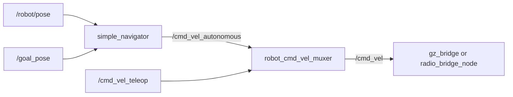
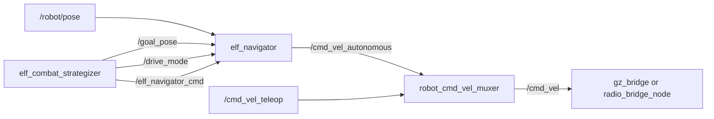
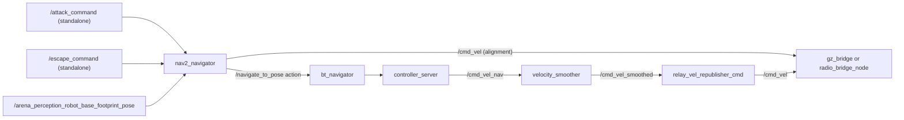

# robot_navigation

The navigator receives a goal pose, robot pose and other driving style commands and uses that information to
compute linear and
angular velocity commands as `geometry_msgs/msg/Twist` on
`/cmd_vel_autonomous` for the robot to drive there.

The combat strategizer chooses the goal pose and driving style.
`robot_cmd_vel_muxer` selects between autonomous and teleop velocity commands
and publishes the result on `/cmd_vel`.
[Autonomy overview](../autonomy.md) · [Combat strategizer guide](combat_strategizer.md) · [robot_cmd_vel_muxer](robot_bringup.md#robot_cmd_vel_muxer)

## Variants

There are different variants of navigators available:

| Navigator | Role | How it moves the robot |
| --- | --- | --- |
| `simple_navigator` | Original direct-pursuit controller | Steers forward toward a goal pose. |
| `elf_navigator` | Default controller | Tracks a goal forward or backward and handles immediate commands from the Elf strategizer. |
| `nav2_navigator` | Optional Nav2 example | Aligns the robot locally, then hands the destination to Nav2 for path planning and tracking. |

## simple_navigator

`simple_navigator` receives `/robot/pose` and `/goal_pose` as
`geometry_msgs/msg/PoseStamped`. At 30 Hz it steers toward the goal with
proportional and integral yaw control. It adjusts forward speed based on
distance and heading error, and publishes zero velocity within the position
tolerance. [Navigator source](../../src/robot_navigation/robot_navigation/simple_navigator.py)

The navigator keeps the last robot and goal poses until new ones arrive. When
their frames differ, it looks up a TF transform but computes the error using
the original coordinates. Supply both poses in the same frame for meaningful
steering. Arrival uses position alone.

| Launch | Controller settings |
| --- | --- |
| [`simple_autonomy.launch.py`](../../src/combat_strategizer/launch/simple_autonomy.launch.py) | Starts the strategizer and navigator with source defaults. The linear speed cap is 1.0 m/s, the angular speed cap is 3.5 rad/s, and the position tolerance is 0.1 m. |
| [`simple_nav.launch.py`](../../src/robot_navigation/launch/simple_nav.launch.py) | Starts the navigator on its own and loads [`simple_navigator_config.yaml`](../../src/robot_navigation/config/simple_navigator_config.yaml). The speed caps are 0.1 m/s and 2.0 rad/s, and the position tolerance is 0.05 m. |

### Proposed improvement

- Apply the transform before computing position error.

## elf_navigator

`elf_navigator` also tracks `/goal_pose` using `/robot/pose`, with a 20 Hz
control loop. The strategizer sends `FORWARD` or `BACKWARD` on `/drive_mode`.
In reverse, the navigator steers the rear of the robot toward the goal and
commands negative linear velocity. It compares the pose coordinates directly,
uses position to determine arrival, and publishes zero once on arrival before
ending goal tracking.
[Navigator source](../../src/robot_navigation/robot_navigation/elf_navigator.py)

### Immediate commands

`/elf_navigator_cmd` carries a `std_msgs/msg/String`. Elf sends `STOP` to clear
the active goal and publish zero velocity, and `BACKWARD:0.5` by default to
start a straight reverse during wall recovery. The navigator publishes one
velocity message per command. The strategizer times the recovery and sends the
next stop, while `robot_cmd_vel_muxer` keeps publishing the last autonomous
command.

The parser also accepts `FORWARD`, `TURN`, `TURN_LEFT`, and `TURN_RIGHT` with
optional speed values. It clears tracking before validating the action, and
invalid numeric text can raise an exception.

| Setting | Source default |
| --- | --- |
| Goal tracking speed caps | `forward_speed=3.0`, `backward_speed=3.0` m/s, `turn_speed=3.5` rad/s |
| Goal tracking gains | `linear_kp=1.0`, `angular_kp=1.8`, `angular_ki=0.5`, `integral_windup_limit=2.0` |
| Arrival | `position_tolerance=0.1` m |
| Immediate command speeds | `default_linear_speed=0.3` m/s, `default_angular_speed=3.0` rad/s |

### Proposed improvement

- Reject malformed commands and stop when inputs expire.

## nav2_navigator

`nav2_navigator` is an optional example for comparing local pose tracking
with path planning. It takes the robot pose from
`/arena_perception_robot_base_footprint_pose`. It turns toward the opponent
using a 10 Hz PID loop, then sends a `nav2_msgs/action/NavigateToPose` goal to
`bt_navigator` on `/navigate_to_pose`. An attack uses the opponent as the
destination. An escape faces the opponent first and then sends a safe
destination.
[Navigator source](../../src/robot_navigation/robot_navigation/nav2_navigator.py)

The standalone executable takes `PoseStamped` commands on `/attack_command`
and `/escape_command`. Its escape demo uses (0, 0) as the safe destination.
`nav2_attack` inherits the wrapper and calls its methods directly. The wrapper
uses the configured goal frame label without transforming the coordinates.
Any completed action result returns it to `IDLE`, including a failed or
canceled goal. Cancellation is asynchronous, so an old result can also affect
the current state. [Nav2 strategy](combat_strategizer.md#nav2_attack)

[`nav2.launch.py`](../../src/robot_navigation/launch/nav2.launch.py) starts the
external Nav2 servers, `map_server`, and `relay_vel_republisher_cmd`. Start
`nav2_navigator` or the `nav2_attack` executable separately. The launch uses
[`nav2_params.yaml`](../../src/robot_navigation/config/nav2_params.yaml) with
DWB by default. Set `params_file` to
[`nav2_params_mppi.yaml`](../../src/robot_navigation/config/nav2_params_mppi.yaml)
to select MPPI. Both configurations expect `/odom`, which standard bringup
does not supply. Both reference the supplied behavior tree for planning, path
following, and recovery. [Behavior tree](../../src/robot_navigation/config/bt_navigator.xml)

`nav2_navigator` and `relay_vel_republisher_cmd` publish directly to
`/cmd_vel`, so running them alongside `robot_cmd_vel_muxer` gives the drive
topic multiple publishers. `relay_vel_republisher_cmd` takes
`/cmd_vel_smoothed` directly. The configured `collision_monitor` output is
`/cmd_vel_collision`.

### Proposed improvement

- Track goal IDs so results from canceled actions cannot complete the current
  maneuver.

## Map tools

| Tool | Purpose |
| --- | --- |
| [`create_map`](../../src/robot_navigation/robot_navigation/create_map.py) | Offline CLI that creates an arena image and writes `map.pgm`, `map_view.png`, and `my_map.yaml`. |
| [`map_node`](../../src/robot_navigation/robot_navigation/map_node.py) | Defense experiment that darkens the area around the opponent on an arena map and selects the brightest pixel as a candidate escape point. |

`map_node` reads `map.pgm` and the `map_size`, `origin`, and `real_size`
fields in `my_map.yaml`. It reads
`/arena_perception_opponent_base_footprint_pose` and publishes
`/map_defence` (occupancy grid), `/map_debug_image` (mono8 image), and
`/defense_position` (point in `map`) at 1 Hz. The active strategies choose
defense positions independently.

### Proposed improvements

- **`create_map`**. Use explicit units for square length and write to a
  caller-selected output directory.
- **`map_node`**. Select a reachable free cell using a recent opponent pose.

## Package improvements

- Expose mutually exclusive controller profiles and normalize goal, pose,
  completion and output contracts.
- Integrate Nav2's odometry, sensor, and output requirements explicitly before
  treating it as interchangeable with Elf.
- Separate offline asset generation from runtime map access. Declare direct
  action, `topic_tools`, image, and scientific Python dependencies and add
  behavior tests for frame conversion, failure and cancellation.
